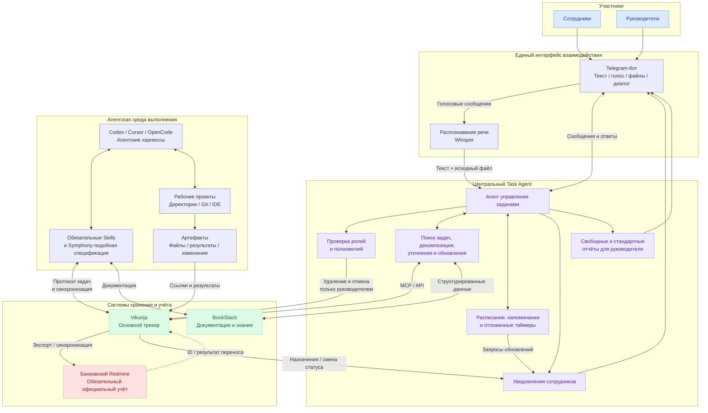
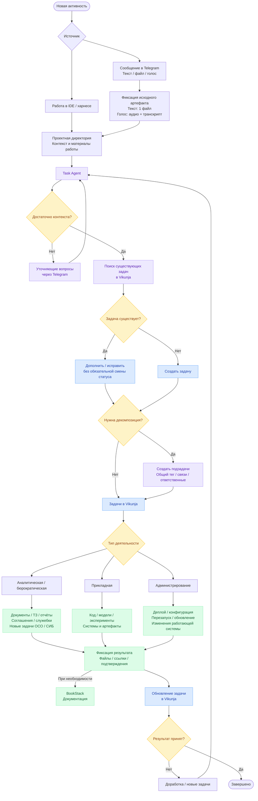
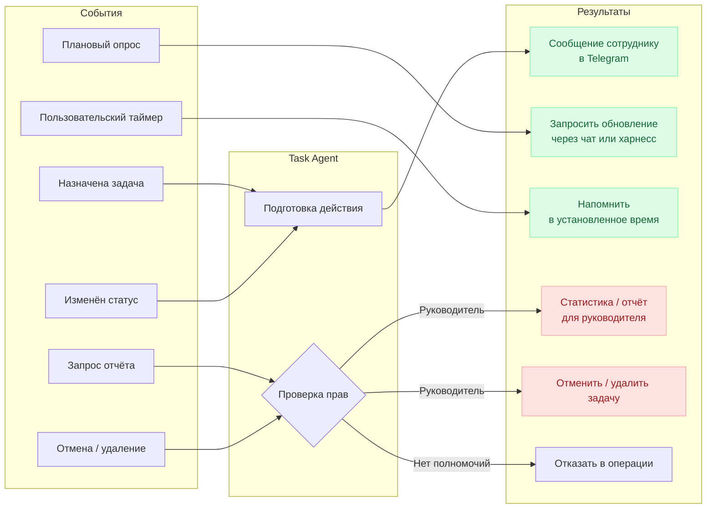
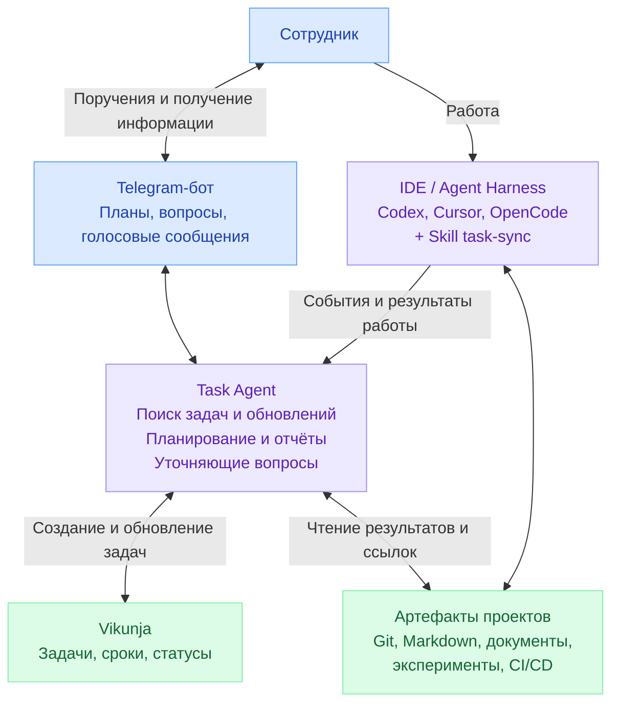
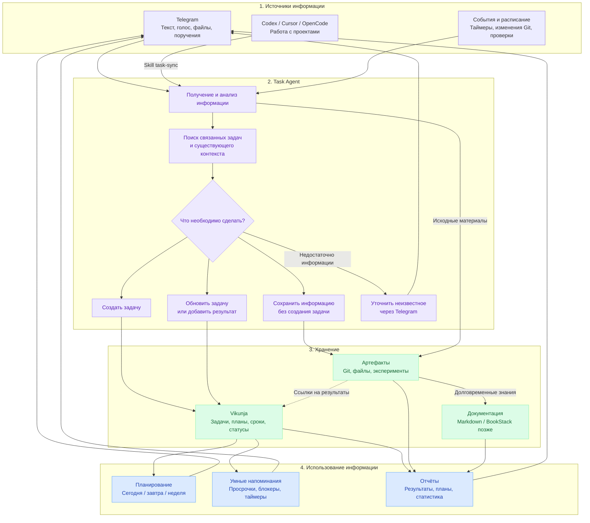
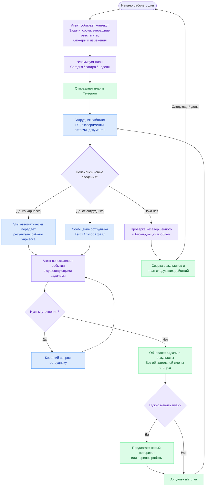
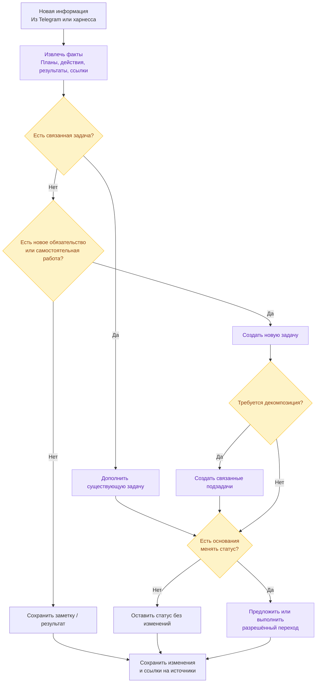

# Task Agent — концепция облегчённой системы управления задачами

> **Единый конспект обсуждения:** исходные требования, сравнение подходов, эволюция архитектуры, все семь Mermaid-диаграмм, процессная модель и план MVP. Составлено по текущему диалогу 8 ноября 2026 года. Это **сводный рабочий документ, а не дословная стенограмма**.
>
> **Статус:** концепция и процессные схемы; окончательное мини-ТЗ и технические контракты ещё не согласованы.

## Содержание

1. [Зачем создаётся система](#1-зачем-создаётся-система)
2. [Контекст и ограничения](#2-контекст-и-ограничения)
3. [Что обсуждали о подходах AI-компаний](#3-что-обсуждали-о-подходах-ai-компаний)
4. [Выбор платформы](#4-выбор-платформы)
5. [Полный исходный перечень пожеланий](#5-полный-исходный-перечень-пожеланий)
6. [Упрощения и текущие решения](#6-упрощения-и-текущие-решения)
7. [Основные сценарии](#7-основные-сценарии)
8. [Процессная модель и данные](#8-процессная-модель-и-данные)
9. [Все Mermaid-диаграммы](#9-все-mermaid-диаграммы)
10. [Функции MVP и критерии качества](#10-функции-mvp-и-критерии-качества)
11. [Интеграции, риски и ограничения](#11-интеграции-риски-и-ограничения)
12. [Порядок следующих шагов](#12-порядок-следующих-шагов)
13. [Открытые решения](#13-открытые-решения)
14. [Ссылки и файлы схем](#14-ссылки-и-файлы-схем)

## 1. Зачем создаётся система

**Главная цель:** максимально комфортно и автоматизированно вести задачи, не заставляя сотрудников постоянно заполнять трекер.

Система должна решать **ровно две пользовательские задачи**:

1. Помогать понять, **что делать сегодня, завтра и в течение недели** с учётом приоритетов, сроков, прогресса и блокеров.
2. **Сохранять планы, историю работы, результаты и документацию**, чтобы затем получать отчёты на основании фактов и исходных артефактов.

Идеальное состояние: сотрудник работает в привычной IDE/харнессе, создаёт код, документы, эксперименты и изменения, а Task Agent без лишних действий с его стороны обновляет задачи. Если работу нельзя увидеть автоматически (например, устная договорённость), сотрудник отправляет боту короткое текстовое/голосовое сообщение. Агент спрашивает только то, что нельзя определить по источникам.

**Что не является целью:** строить собственный большой таск-трекер, новую платформу процессов, контроль ради контроля, обязательные ежедневные отчёты, сложные проектные регламенты для каждой мелочи.

## 2. Контекст и ограничения

- В банке используется сильно модифицированный Redmine; создание задач и их сопровождение слишком бюрократизированы. Он остаётся обязательной корпоративной системой, но не должен быть основным интерфейсом повседневной работы.
- Основная работа подразделения — AI/ML, исследовательские эксперименты, инфраструктура, разработка и организационные мероприятия. У разных видов работы разные результаты.
- Используются или обсуждаются агентские харнессы **Codex, Cursor, OpenCode**, существующий ChatCI и Whisper для STT.
- Желательны **on-premise / собственный контур**, простые компоненты, минимальные затраты на сопровождение; внутри продакшена есть ограничения на Docker.
- Пользовательский диалог в исходной концепции — через Telegram; в закрытом банковском контуре допустимость такого канала для служебных данных требует отдельной проверки. Для чувствительных сведений возможен внутренний интерфейс ChatCI.
- Не следует считать событие в Git доказательством полного завершения задачи. Система должна разделять обнаруженный факт, гипотезу агента и подтверждённый результат.

## 3. Что обсуждали о подходах AI-компаний

В обсуждении использовались следующие ориентиры (это **публично описанные практики и идеи**, а не подтверждённая реконструкция внутренних процессов каждой компании):

- **OpenAI:** Linear и агентская оркестрация по мотивам **Symphony**; постановка задачи становится входом в автоматизированное исполнение и ревью. Разделение задач, зависимостей, исполнителей-агентов, PR и подтверждений.
- **Anthropic:** идея командного агента, доступного из повседневного чата (в обсуждении упоминался Claude Tag/Slack), который принимает поручения, возвращается с уточнениями и использует инструменты. Сами внутренние процессы Anthropic нельзя свести к единому публично известному регламенту.
- **DeepSeek:** для точного описания конкретного трекера и регламентов не хватает подтверждённых данных; заимствовать можно общую идею самостоятельной исследовательской работы, но не приписывать компании неизвестный стек.
- **Вывод:** полезнее перенимать не конкретную систему, а принцип: **человек задаёт цель и проверяет содержательный результат, агент ведёт рутину по задачам и артефактам**.

## 4. Выбор платформы

| Вариант | Роль в концепции | Решение на текущий момент |
|---|---|---|
| **Vikunja** | Основной лёгкий self-hosted трекер, API/MCP, Kanban, сроки, задачи | **Базовый выбор для MVP** |
| **Plane** | Более богатая модель проектов, циклов и зависимостей | Альтернатива при усложнении процессов |
| **Linear** | Эталон UX и агентских сценариев | Ориентир; облачная модель может не подходить банковскому контуру |
| **Huly** | Единое рабочее пространство и трекинг | Не брать на пилот без конкретной потребности |
| **GitHub Projects** | Инженерные задачи и связь с PR | Не заменяет единый лёгкий слой управления работой подразделения |
| **BookStack** | Долговременная документация | Отложено: сначала Markdown/артефакты рядом с проектами |
| **Корпоративный Redmine** | Официальный учёт | Отложенная выгрузка/синхронизация после пилота |

Ранее для стартапа сравнивали варианты **Plane + GitHub** и **Vikunja + BookStack**. В текущей итерации приоритет смещён к **Vikunja + Task Agent + харнессам**, а BookStack отложен.

## 5. Полный исходный перечень пожеланий

Ниже сохранён **исходный замысел до упрощения**. Он важен как реестр пожеланий, но **не означает**, что всё необходимо реализовать сразу.

### 5.1. Компоненты

1. Агентский харнесс для работы: Codex / Cursor / OpenCode и аналогичные.
2. Обязательные навыки (skills) для проектов и трекера, спецификация наподобие Symphony.
3. Telegram-бот.
4. Сотрудники и руководители.
5. Официальная банковская система задач (форк Redmine).
6. Vikunja для задач.
7. BookStack для документации.

### 5.2. Три типа задач в первоначальной модели

| Тип | Примеры | Ожидаемый результат |
|---|---|---|
| Аналитические / бюрократические | Аналитика, встречи, обсуждения, менеджмент, отчёты, служебные записки, задачи на ОСО и СИБ | Решения, ТЗ, документы, отчёты, планы, поручения, новые задачи |
| Прикладные | Разработка, тестирование, ML-эксперименты, исследования | Код, системы, результаты экспериментов, модели и другие артефакты |
| Администрирование | Деплой, конфигурация, перезагрузка, обновление | Подтверждённые изменения работающих систем |

**Изменение в MVP:** жёсткая классификация не требуется. Тип может выводиться агентом по содержанию, когда он реально помогает отчётности.

### 5.3. Исходные правила учёта

8. Любая существенная активность должна быть представлена проектом в IDE/харнессе **или хотя бы минимальным артефактом**.
9. Пример аналитической активности (переписка о договорённостях): директория; файл с перепиской; аналитический результат (отчёт, ТЗ, план, схема, список задач и ссылок); основная задача и, если необходимо, порождённые задачи.
10. Минимальный артефакт: текстовый файл или сообщение боту (один файл); голосовое сообщение с транскриптом (аудио + текст).
11. Задача может пополняться и корректироваться **без смены статуса**.
12. Большую задачу агент может декомпозировать на связанные подзадачи с общим тегом, учитывая пожелания пользователя.
13. Агент задаёт уточняющие вопросы.
14. Диалоговое взаимодействие с агентом через Telegram-бота; работа в IDE и синхронизация через skill/API.
15. При постановке задачи или изменении её статуса агент уведомляет назначенного сотрудника.
16. В заданное время агент просит обновить задачи (лучше сначала собирает сведения автоматически, затем при необходимости уточняет через чат).
17. Поддерживаются таймеры: «создай задачу и напомни через час дополнить».
18. Только руководитель в исходном замысле отменяет/удаляет задачи и получает свободные/стандартные отчёты. **Для быстрого MVP сложная ролевая модель отложена**; доступы всё равно должны соблюдаться на уровне интеграций и трекера, а разрушительные операции не выполняться бесконтрольно.

## 6. Упрощения и текущие решения

**Текущий приоритет — простота, комфорт, отсутствие отчётности ради отчётности.**

| Первоначальная идея | Принятое упрощение |
|---|---|
| Отдельная директория для любой активности | Директория только для содержательной работы; краткие заметки/сообщения могут жить без неё |
| Обязательные 3 типа задач | Одна универсальная задача, тип — необязательный атрибут |
| Подробная Symphony-подобная спецификация | Один лёгкий `task-sync` skill + минимальный контракт событий |
| BookStack как обязательное хранилище | Документы и результаты остаются рядом с проектами; BookStack подключать позже |
| Частые обязательные опросы | Сначала анализ событий, затем точечный вопрос только при нехватке данных |
| Автоматическая декомпозиция каждой большой активности | Декомпозиция только когда помогает исполнению и обозримости |
| Постоянная интеграция с форком Redmine | Сначала обкатать Vikunja и агента, позже односторонний экспорт |
| Сложная ролевая модель в архитектурной схеме | Не перегружать MVP; использовать простые разрешения и подтверждение опасных изменений |
| Сложные состояния | Четыре состояния: `Нужно сделать` / `В работе` / `Заблокировано` / `Завершено` |
| «Любая активность = новая задача» | Различать создание задачи, обновление задачи и сохранение заметки/результата |

**Архитектурный принцип:** один разговорный интерфейс (Telegram, при допустимости использования), один Task Agent, один основной трекер (Vikunja), существующие рабочие артефакты, один синхронизирующий skill для IDE/харнесса.

**Два режима взаимодействия:**

- **Пассивный:** сотрудник сам запрашивает план, создаёт поручения, отправляет файл/голос, просит отчёт; агент обрабатывает события из харнесса.
- **Проактивный:** бот отправляет план, при необходимости уведомляет о блокере/просрочке и задаёт вопросы, если источники не дают достаточного контекста.

Для пилота: пассивный режим + **одно утреннее сообщение**; дополнительные уведомления вводить после оценки их полезности.

## 7. Основные сценарии

### 7.1. Узнать, чем заниматься сегодня / завтра / на неделе

**Пример запроса:** «Что мне сегодня делать?»

Агент читает задачи и подтверждённые последние результаты, различает **дедлайн** и **плановый день работы**, учитывает блокеры и предлагает упорядоченный план. По просьбе показывает завтрашние задачи и недельный горизонт.

**Результат:** компактная подборка с названиями, ближайшим действием, источником контекста и ссылкой на задачу. Показать план — не означает автоматически менять дедлайны.

### 7.2. Автоматическое обновление после работы в харнессе

Сотрудник выполняет работу в Codex/Cursor/OpenCode. Интеграция получает доступные события: изменённые файлы, Git commits/PR, тесты, результаты экспериментов, возможно краткое резюме сессии. `task-sync` передаёт структурированное событие агенту.

Агент ищет существующую задачу, добавляет **факты** и ссылки, фиксирует следующее действие. Статус меняется только при достаточных основаниях. **Один skill не гарантирует, что любая IDE предоставит полный поток событий**: hooks и форматы истории требуют проверки по каждому харнессу.

### 7.3. Голосовая постановка задачи или фиксация договорённостей

**Пример:** «Обсудили обновление ChatCI; решили перенести память, проверить latency и подготовить миграцию».

Бот принимает аудио, получает транскрипт, агент находит похожие задачи и сохраняет договорённости. Новые обязательства оформляет задачами; если неясен исполнитель, спрашивает. Исходный материал сохраняется по применимой политике хранения; в самой задаче достаточно ссылки на первоисточник и кратких результатов.

### 7.4. Быстрое делегирование поручения

**Пример:** «Сравнить Qwen3 Embedding и BGE-M3 на корпоративном поиске, оценить качество, latency и VRAM; результаты на следующей неделе».

Агент создаёт черновик с понятным результатом и критериями готовности, ищет дубликаты, при необходимости уточняет исполнителя или конкретный срок. Не придумывает данные, которых не было.

### 7.5. Обновление существующей задачи без смены состояния

**Пример:** «Разобрался с батчингом, обнаружил проблему KV-cache; завтра продолжу тесты».

Агент дополняет историю и следующее действие в существующей задаче. `В работе` остаётся `В работе`; обнаруженная проблема не всегда равнозначна статусу `Заблокировано`.

### 7.6. Напоминания и уточнения

Пользователь может попросить напомнить через час или в конкретное время. Если агент обнаружил неясность, задаёт **один короткий адресный вопрос**. Не рассылает многократные напоминания, когда прогресс уже зафиксирован через харнесс.

### 7.7. Свободные и стандартные отчёты

**Пример:** «Что сделали за неделю по ChatCI? Что блокирует работы?»

Ответ собирается из задач, прогресса, Git/PR, документов, артефактов экспериментов. Отчёт должен различать **подтверждённое**, **предполагаемое** и **неизвестное**, указывать ссылки на источники; не выдумывать достижения.

### 7.8. Переоценка актуальности

При длительной неактивности, изменении архитектуры или исчезновении необходимости агент предлагает пересмотреть задачу. Не бесконечно напоминает о том, что уже могло потерять актуальность. Отмена/удаление требуют контролируемого решения.

## 8. Процессная модель и данные

### 8.1. Непрерывный цикл

**Планирование → Выполнение → Автоматический сбор событий → Фиксация результатов → Актуализация задач → Перепланирование → Отчёты → Следующий цикл.**

### 8.2. Три сущности

| Сущность | Смысл | Пример |
|---|---|---|
| **Задача** | Что нужно сделать и какой ожидается результат | «Снизить latency инференса Qwen» |
| **Активность** | Что фактически происходило | Сессия агента, запуск benchmark, обсуждение, встреча |
| **Артефакт** | Что получилось / что подтверждает событие | PR, документ, тестовый отчёт, модель, конфигурация |

Одна задача может содержать много активностей и артефактов; одна активность может касаться нескольких задач. **Не каждую активность нужно превращать в отдельную задачу**.

### 8.3. Минимальная карточка задачи

**Обязательное для человека:** короткое понятное название и ожидаемый результат (если известен). Остальное система может предложить или заполнить из контекста.

**Данные задачи:** ID, название, проект/направление, состояние (`Нужно сделать`, `В работе`, `Заблокировано`, `Завершено`), исполнитель (если определён), дедлайн (если есть), **когда планируется работать** (`Сегодня`, `Завтра`, `Неделя`, `Позже`), последний подтверждённый результат, следующий шаг, ссылки на источники и артефакты. Приоритет — только когда полезен.

**Важное различие:** ожидаемый срок готовности и плановая дата работы — разные поля/представления.

### 8.4. Три категории автоматических выводов

1. **Наблюдаемый факт:** создан PR, выполнен CI, изменён файл, есть результат эксперимента. Можно записать со ссылкой на источник.
2. **Предположение агента:** вероятно, задача продвинулась или возникла подзадача. Отмечать как предположение/предложение, не выдавать за доказанный факт.
3. **Требуется человек:** неизвестны договорённость, исполнитель, приоритет или критерии приёмки. Задать короткий вопрос.

### 8.5. Логика обработки нового события

- Извлечь факты, намерения, новые обязательства и ссылки.
- Найти существующие задачи; при неоднозначном совпадении не создавать дубликаты автоматически.
- Если это прогресс по задаче — добавить результат, при необходимости обновить следующее действие.
- Если это новое самостоятельное обязательство — создать задачу/черновик.
- Если это только информация — сохранить заметку/артефакт без новой задачи.
- Декомпозировать лишь при реальной пользе и с учётом предпочтений пользователя.
- Менять статус только при проверяемых условиях; завершение критичных работ не считать подтверждённым без предусмотренной проверки.

## 9. Все Mermaid-диаграммы

В Markdown диаграммы встроены как `mermaid` блоки и доступны как самостоятельные `.mmd` файлы в каталоге [`diagrams/`](diagrams/). **Актуальные для MVP схемы: 04–07; 01–03 — исходные варианты, сохранены для истории решений.**

### 09.1. Первая версия: полная архитектура (историческая)

Ранняя более сложная схема со всеми системами, ролями, уведомлениями и Redmine. **Не является архитектурой рекомендованного MVP.**

**Файл:** [`diagrams/01_initial_system_architecture.mmd`](diagrams/01_initial_system_architecture.mmd)

### 09.2. Первая версия: жизненный цикл активности (историческая)

Ранняя схема с обязательными проектными директориями и тремя типами работ. Используется как источник требований; позже упрощена.

**Файл:** [`diagrams/02_initial_activity_lifecycle.mmd`](diagrams/02_initial_activity_lifecycle.mmd)

### 09.3. Первая версия: уведомления и полномочия (историческая)

Ранняя отдельная схема ролей и контроля; полномочия убраны из центральной схемы MVP, но ограничения безопасности остаются.

**Файл:** [`diagrams/03_initial_notifications_permissions.mmd`](diagrams/03_initial_notifications_permissions.mmd)

### 09.4. Актуальная: упрощённая архитектура MVP

Основная техническая схема для первого прототипа: Telegram, Task Agent, Vikunja, харнесс и существующие артефакты.

**Файл:** [`diagrams/04_simplified_mvp_architecture.mmd`](diagrams/04_simplified_mvp_architecture.mmd)

### 09.5. Актуальная: основные процессы

Поток событий и развилка «создать задачу / дополнить / сохранить заметку / уточнить». Планы, напоминания, отчёты.

**Файл:** [`diagrams/05_core_processes.mmd`](diagrams/05_core_processes.mmd)

### 09.6. Актуальная: ежедневный цикл сотрудника

Сквозная модель от утреннего плана до результата и следующего рабочего дня.

**Файл:** [`diagrams/06_daily_employee_cycle.mmd`](diagrams/06_daily_employee_cycle.mmd)

### 09.7. Актуальная: решение по событию и задаче

Защита от дублей, лишней декомпозиции и необоснованной смены статуса.

**Файл:** [`diagrams/07_event_to_task_decision.mmd`](diagrams/07_event_to_task_decision.mmd)

## 10. Функции MVP и критерии качества

### 10.1. Обязательные функции первого пилота

1. Создать задачу из текста, голоса или файла через бота.
2. Найти существующую задачу и дополнить описание, историю или следующий шаг **без обязательной смены статуса**.
3. Получить структурированное обновление из одного выбранного харнесса и связать его с задачей.
4. Показать персональный план на сегодня, завтра, неделю.
5. Напомнить о задаче в указанное время; необязательная утренняя сводка.
6. Сформировать недельный отчёт по задачам и подтверждённым артефактам.
7. Задать уточняющий вопрос при недостатке фактов или конфликте кандидатов на задачу.

### 10.2. Отложенные функции

- BookStack как полноценное единое пространство знаний и автоматическая публикация документов.
- Отправка/синхронизация задач в банковский Redmine.
- Глубокая интеграция нескольких IDE и автономный запуск coding-агентов из задач по модели Symphony.
- Сложная декомпозиция, межкомандные зависимости, управление портфелями и расширенные статусы.
- Продвинутые роли, кастомные согласования и отдельный UI для администрирования (с соблюдением базовой безопасности с первого дня).

### 10.3. Показатели полезности пилота

| Метрика | Как проверять |
|---|---|
| Время создания поручения | От первого сообщения до корректной карточки |
| Доля обновлений без ручного ввода | Из событий харнесса / Git / файлов |
| Частота дубликатов | Сколько лишних задач создано агентом |
| Правильность сопоставления | Правильно ли событие привязано к задаче |
| Ложные завершения | Случаи, когда статус `Завершено` был выставлен без оснований |
| Полезность плана | Помогает ли список «сегодня/завтра/неделя» выбрать действие |
| Нагрузка уведомлениями | Количество ненужных вопросов и сообщений |
| Качество отчёта | Проверяемость фактов по ссылкам на артефакты |

Конкретные пороговые значения ещё не согласованы — они должны быть поставлены после базового замера.

## 11. Интеграции, риски и ограничения

### Telegram и конфиденциальность

Бот удобен как диалоговый канал, однако служебные данные и результаты банковских проектов нельзя автоматически направлять через внешний мессенджер без разрешённой политики обработки. Для закрытых данных использовать согласованный внутренний канал, например ChatCI. Тот же Task Agent может обслуживать оба интерфейса, но с разными разрешениями.

### Надёжность и права

- Отделять **чтение/предложение** от **изменения** состояния.
- Хранить автора, основание, время и ссылку на исходное событие каждой агентской правки.
- Использовать идемпотентность для повторных событий (одно событие ≠ две задачи).
- Для массовых и разрушительных операций требовать подтверждение и сохранять журнал.
- Принцип минимальных разрешений для токенов Vikunja, Git, корпоративных систем.
- Не считать итогом работы только текст резюме модели, если можно проверить PR, тест или артефакт.

### Ограничения интеграции с харнессами

Не каждый харнесс предоставляет одинаковые события, hooks и историю. Для MVP выбрать **один** харнесс и реализовать лёгкий `task-sync` контракт: `source`, `session_id`, `timestamp`, `project`, `task_hint`, `facts`, `artifacts`, `next_step`, `confidence`, `deduplication_key`. Затем проверить, какие данные доступны надёжно.

### Будущая интеграция с Redmine

Редмайн в банке сильно кастомизирован, поэтому штатный REST API нужно проверить. На первом этапе лучше односторонняя выгрузка с согласованием полей, хранением соответствия ID, журналом операций и безопасными повторами. Не пытаться автоматически обходить обязательные корпоративные процессы.

## 12. Порядок следующих шагов

### Шаг 1. Утвердить процессную карту (сейчас)

Принять схемы **04–07** за базу. Проверить 6–8 реальных кейсов: новое поручение; работа в IDE; эксперимент; встреча; заметка без задачи; конфликт двух похожих задач; перенос срока; недельный отчёт.

### Шаг 2. Мини-ТЗ для Task Agent

Описать входы (текст/голос/файлы/события), выходы, минимальный словарь действий (`find`, `create`, `append`, `change_status`, `plan`, `remind`, `report`), обработку ошибок и правило «не уверен — уточни». Сформулировать разрешения и подтверждения на чувствительные операции.

### Шаг 3. Спецификация `task-sync`

Определить единый формат события из харнесса, способы связи события с задачей, правила дедупликации, retry, режим без сети и совместимость с конкретным первым харнессом.

### Шаг 4. Минимальный технический пилот

Поднять Vikunja, связать его API/MCP с Task Agent, подключить разрешённый диалоговый канал, добавить STT и один источник событий IDE/Git. Не внедрять одновременно BookStack и интеграцию Redmine.

### Шаг 5. Проверка в реальной работе

Пилот 2–3 сотрудников на реальных задачах в течение 1–2 недель. Сравнить время на трекинг до/после, ложные изменения статуса, дубли, полезность планов и качество отчётов. На основании результатов решать, что развивать.

## 13. Открытые решения

1. Где реально разрешён Telegram и какие данные можно передавать в него? Если нельзя — использовать интерфейс ChatCI без изменения ядра агента.
2. Какой харнесс подключать первым: OpenCode, Codex или Cursor? Какие у него доступны события?
3. Какая модель планирования удобнее: день работы в атрибуте задачи, отдельный личный план или вычисляемое представление?
4. Как подтверждать завершение задач: автоматически по проверяемым критериям, вручную или смешанно для разных типов работы?
5. Как хранить первичные аудиосообщения и тексты, сколько времени и с какими правами доступа?
6. Когда и как включать выгрузку в Redmine после доказанной полезности MVP?

## 14. Ссылки и файлы схем

**Все семь `.mmd` файлов** находятся в `diagrams/`:

- [`01_initial_system_architecture.mmd`](diagrams/01_initial_system_architecture.mmd) — первая полная архитектура (архив).
- [`02_initial_activity_lifecycle.mmd`](diagrams/02_initial_activity_lifecycle.mmd) — первая модель жизненного цикла (архив).
- [`03_initial_notifications_permissions.mmd`](diagrams/03_initial_notifications_permissions.mmd) — первая схема контроля (архив).
- [`04_simplified_mvp_architecture.mmd`](diagrams/04_simplified_mvp_architecture.mmd) — **актуальная упрощённая архитектура**.
- [`05_core_processes.mmd`](diagrams/05_core_processes.mmd) — **основные процессы**.
- [`06_daily_employee_cycle.mmd`](diagrams/06_daily_employee_cycle.mmd) — **ежедневный цикл**.
- [`07_event_to_task_decision.mmd`](diagrams/07_event_to_task_decision.mmd) — **логика обработки события**.

Полезные проекты и документация, упоминавшиеся в обсуждении:

- OpenAI Symphony — <https://github.com/openai/symphony>
- OpenAI Harness Engineering — <https://openai.com/index/harness-engineering/>
- OpenAI Symphony / orchestration — <https://openai.com/index/open-source-codex-orchestration-symphony/>
- Vikunja — <https://vikunja.io/>
- Plane — <https://plane.so/>
- Linear — <https://linear.app/>
- BookStack — <https://www.bookstackapp.com/>
- Redmine API — <https://www.redmine.org/projects/redmine/wiki/Rest_api>

> Примечание: все ссылки и упоминания внешних систем перенесены из беседы, а не перепроверены в момент генерации этого Markdown-файла.
