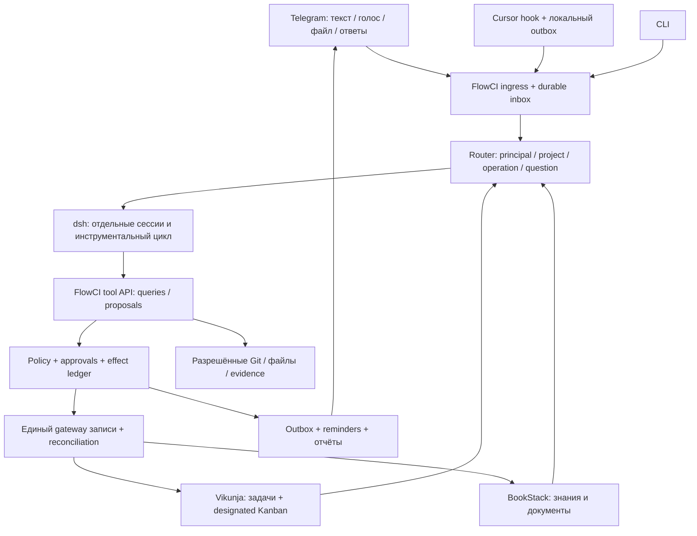

# ТЗ: FlowCI — Task Agent на DeepSeek Harness, BookStack и согласованном Kanban

**Идентификатор:** `flowci-agent-platform`  
**Версия:** 1.0, 9 ноября 2026, Europe/Moscow  
**Тип:** аналитическое техническое задание для будущей реализации агентами  
**Статус:** спецификация; реализация, установка компонентов и миграция этим документом не выполнены.

## 1. Назначение и порядок применения

Документ задаёт целевую доработку всей системы FlowCI: пользовательские сценарии, архитектуру, данные, разрешения, интеграции, восстановление, миграцию и доказательства готовности. Агент реализации должен иметь возможность начать работу по этому файлу без чтения переписки. Ссылки на старые документы и внешние API служат источниками и дополнительными доказательствами; обязательные решения и правила изложены здесь.

Требование **«обязательно»** означает условие завершения данной feature. **«Отложено»** означает явно исключённую функцию, а не разрешение заменить обязательный компонент заглушкой. Все API ниже с префиксом FlowCI — проектируемые контракты, а не описание уже существующих endpoints.

При противоречии со старым README/концепцией для этой feature действуют следующие новые решения пользователя:

| ID | Решение |
|---|---|
| DEC-01 | **BookStack обязателен в ближайшей целевой версии.** Чтение, публикация, обновление знаний и связи с задачами входят в эту работу. Формулировка «BookStack подключим потом» отменена. |
| DEC-02 | **DeepSeek Harness (`dsh`) — целевой разговорный и инструментальный runtime Task Agent.** Требуется заменить соответствующую самописную оркестрацию, а не только обернуть `llm.complete()` другим вызовом. Совместимость должна пройти обязательный capability gate. |
| DEC-03 | Vikunja остаётся источником состояния задач; используется её настоящий Kanban с карточками и согласованным жизненным циклом. Свой таск-трекер и отдельный пользовательский dashboard не строятся. |
| DEC-04 | FlowCI сохраняет ответственность за права, происхождение сведений, предложения правок, подтверждения, очередь, журнал внешних эффектов и восстановление. История dsh их не заменяет. |
| DEC-05 | Telegram, CLI и один действующий источник IDE-событий — Cursor — обязательны. Архитектура допускает другой канал/харнесс, но подключение всех IDE и ChatCI одновременно не требуется. |
| DEC-06 | Дедлайн и дата планируемой работы различаются. Сессия/коммит не закрывают задачу. Несколько связанных действий одной просьбы допустимы и выполняются с журналом шагов. |
| DEC-07 | Поиск старых локальных notes за пределами последних 20 и сортировка равных сроков по priority не становятся новыми блокерами этой feature. Их данные сохраняются. Это исключение **не распространяется** на поиск по обязательному BookStack. |

Обоснованный пересмотр решения DEC-02 возможен только отдельным ADR с доказанной несовместимостью и явным решением владельца продукта. Нельзя молча оставить прежний JSON/slot runtime, назвав его интеграцией dsh. Рутинные технические решения в пределах ТЗ исполнитель принимает самостоятельно и документирует; они не требуют повторного согласования каждого шага.

## 2. Продуктовая цель и границы

Система решает две основные задачи:

1. Помогает сотруднику понять, что делать сегодня, завтра и на неделе, с учётом сроков, плана, результатов и блокеров.
2. Сохраняет обязательства, историю деятельности, первичные результаты и устойчивые знания так, чтобы их можно было найти, проверить и использовать в отчёте.

Сотрудник работает в IDE, проводит эксперимент, обсуждает решение или отправляет текст/голос/файл. Агент собирает контекст из разрешённых источников, задаёт адресные уточнения и ведёт рутину. Пользователь не обязан повторно заполнять карточку или переписывать уже приложенный документ.

**Обязательный результат feature:** работающий вертикальный путь `сообщение/IDE → dsh → нужные уточнения → разрешённые операции → Vikunja + BookStack + связи → подтверждённый ответ`, с сохранением результата при частичном отказе.

### 2.1. Что входит

- Создание, поиск и содержательное дополнение задач; назначение доступному пользователю; смена статуса, плана и разрешённого дедлайна.
- Персональный план и недельный отчёт с проверяемыми источниками.
- Текст, голос, вложения; структурированные события Cursor; заметки и знания без лишних задач.
- Полноценная интеграция BookStack и её эксплуатационный контур.
- Реальный Kanban: `Нужно сделать / В работе / Заблокировано / Завершено`, согласованный с ответами агента и `done`.
- Сессии dsh, инструментальный цикл, восстановление и строгая корреляция вопросов/ответов.
- Надёжный приём событий, применение многошаговых изменений, доставка ответов и напоминаний.
- Совместимость и миграция текущих данных; изолированные испытания и настоящий Telegram/Cursor E2E.
- Базовая идентификация нескольких сотрудников и области доступа к проектам/книгам; без сложного административного UI.

### 2.2. Что отложено

- Интеграция с кастомным банковским Redmine, сложные согласования, портфель проектов и корпоративная ролевая модель.
- Автономный запуск coding-агентов из задач по модели Symphony, глубокая интеграция нескольких IDE.
- Обязательный Docker, новый отдельный frontend и универсальная платформа автоматизаций.
- OCR сканов, произвольное выполнение приложенных файлов, анализ произвольных бинарных форматов.
- Две функции DEC-07. Их отсутствие не разрешает обрезать историю при миграции или ограничить поиск BookStack последними 20 страницами.

## 3. Исходное состояние и доказательная база

### 3.1. Что наблюдалось при подготовке ТЗ

В каталоге есть Python-проект `flowci 0.1.0`, `src/flowci`, штатные тесты, bootstrap Vikunja, Cursor skill/hook, локальные БД и архивы ревью. Git metadata отсутствует; идентифицировать baseline одним commit нельзя.

| Часть | Текущая роль / ограничение для планирования |
|---|---|
| `src/flowci/agent.py` | Собственная классификация Decision, policy, диалоги, исполнение и recovery сосредоточены в одном большом модуле. Переносить обязанности по границам, а не дублировать этот модуль внутри dsh. |
| `store.py` | SQLite-журнал, диалоги, подтверждения, outbox, активности, notes, артефакты; уже есть доработки generation/heartbeat/claim. Данные должны быть сохранены. |
| `vikunja.py` | Прямой API-клиент, работа с метками, сохранность полей и блокировки; в текущем коде есть точное сопоставление маркеров и дальнейшие изменения после v3. |
| `telegram.py`, `schedule.py`, `ingest.py`, `cli.py` | Каналы и фоновые задачи уже работают в текущей модели; требуют приведения к общему сервису исполнения и новым контрактам. |
| `.cursor/hooks/task-sync.py` | Структурированное событие, локальный outbox и fail-open hook; сохранить совместимость и независимость IDE от доступности модели. |
| `formatting.py` | Шапки описаний, планы, отчёты, даты и HTML. Представление документа не должно оставаться источником разрешений на изменение данных. |
| `README.md`, `.env.example` | Описывают RouterAI/STT/Telegram/Vikunja и исключают BookStack; при реализации эти формулировки и настройки необходимо обновить. |
| `tests/test_review_integrity.py`, `tests/test_review_v2.py` | Есть регрессии нескольких ревью, но их наличие и исторические числа прохождения не доказывают готовность новой архитектуры. |

По исходникам BookStack-адаптер, его конфигурация и обязательная интеграция отсутствуют; dsh пока не является runtime FlowCI. Исторически в проекте Vikunja существовал manual Kanban с To-Do/Doing/Done; точные IDs/версии и поведение целевого экземпляра необходимо обнаружить заново, без hardcode.

**Важно:** исходники уже изменились после [v3](../reviews/v3.md). G01–G06 и остальные случаи ревью являются обязательными регрессионными обязательствами, а не утверждением, что все дефекты остаются открытыми сегодня. Подготовка ТЗ не включала повторный E2E-аудит и запуск системы.

### 3.2. Локальные источники

- [Исходная концепция](../docs/concept/Task_Agent_Concept.md): цели, типы работы, пользовательские сценарии; её решение об отсрочке BookStack заменено DEC-01.
- [Ревью v1](../reviews/review-2026-11-08-v1.md), [v2](../reviews/v2.md), [v3](../reviews/v3.md).
- Архивы `reviews/evidence/`, `reviews/v2-evidence/`, `reviews/v3-evidence/`: исторические traces и воспроизведения; не перезаписывать для доказательства новой версии.

Перед реализацией зафиксировать хэши актуальных исходников/схем и новый baseline tests. Испытания проводить на отдельных БД/аккаунтах/портах. Рабочий экземпляр Vikunja 3456, существующие токены и `.env` не являются тестовой песочницей.

## 4. Обязательные пользовательские сценарии

| ID | Вход / ситуация | Ожидаемый результат |
|---|---|---|
| SC-01 | Полное текстовое поручение | Одна правильная задача, назначение, результат, независимые deadline/plan; ссылка пользователю. |
| SC-02 | Не хватает исполнителя/срока | 3–5 ходов без потери первоначальных реквизитов. Явное «срока нет» допустимо; неизвестный срок отличается от бессрочного. |
| SC-03 | Два похожих задания | Адресное уточнение; выбранная карточка получает первоначальный результат, дубль не создаётся. |
| SC-04 | «Дополни результат эксперимента», дата измерения в тексте | Сохраняются результат/следующий шаг и источник; deadline/status не меняются без отдельного основания. |
| SC-05 | «Перенеси с X на Y», «убери срок», «срок не меняй» | Применяется соответственно Y, clear или keep; вопрос бота и дата файла не становятся разрешением. |
| SC-06 | Голос / документ | Содержание извлечено, источник сохранён; пользователь не перепечатывает файл. Ошибка распознавания или неподдержанный формат названы явно. |
| SC-07 | Cursor завершил сессию | Факт принят в журнал; найдена задача и страница знаний. Коммит/summary не означают завершение. |
| SC-08 | Два IDE-события A/B и короткие ответы | У каждого свои context, evidence и вопросы. Reply на A исполняет A; stale reply не исполняет B. |
| SC-09 | «Зафиксируй результат и обнови задачу» | Агент читает существующие task/page, выполняет связанные изменения, возвращает ссылки на оба объекта. |
| SC-10 | Решение встречи / инструкция без обязательства | Заметка/страница BookStack с источником; новая задача создаётся только при наличии самостоятельной работы. |
| SC-11 | Существующий документ изменён человеком | Агент обнаруживает конфликт/режим владения, сохраняет чужое содержание и предлагает правку, а не молча затирает его. |
| SC-12 | Статус изменён ботом | Настоящая карточка на designated Kanban оказывается в правильной колонке; `done` и совместимые метки согласованы. |
| SC-13 | Человек перетащил карточку в native Kanban | Агент видит новое состояние; авторизованное действие UI учитывается в истории, без обратного перетирания старой меткой. |
| SC-14 | Сегодня / завтра / неделя и следующий календарный день | Персональный план с датами, блокерами и шагами; просмотр read-only; legacy планы не исчезают. |
| SC-15 | «Напомни через час / завтра в 10 по Москве» | Напоминание адресовано нужному человеку, восстанавливается после рестарта и не считается доставленным без результата канала. |
| SC-16 | Недельный отчёт проекта/сотрудника | Подтверждённые результаты, заявления, предположения, неизвестное и ссылки различимы; task + activity + BookStack + artifacts учтены. |
| SC-17 | Закрытие / удаление / отмена | Правильное подтверждение и аудит; повторное нажатие не исполняет действие ещё раз. Отмена не удаляет уже сохранённые знания. |
| SC-18 | Отказ BookStack после/до записи, отказ Vikunja после публикации | Видимый partial/pending, сохранённые IDs и безопасное продолжение оставшихся шагов. |
| SC-19 | Дубликат, рестарт, долгий запрос, неизвестный сетевой исход | Нет молчаливого изменения чужого объекта, слепого повторного создания или ложного полного успеха. |
| SC-20 | Второй сотрудник, группа Telegram, другой проект | Разрешённый сотрудник обслуживается в своей области; группы и чужие данные не получают ответы/контекст. |

Для всех сценариев обязательны подтверждённые результаты инструментов. Финальная фраза модели «сделано» сама по себе ничего не подтверждает.

## 5. Целевая архитектура и источники истины



| Компонент | Авторитетные данные | Что ему не делегируется |
|---|---|---|
| Vikunja | Задачи, исполнители, deadline, native completion, workflow designated view | Знания не должны жить только в comments. |
| BookStack | Устойчивые документы, решения, инструкции, содержательные результаты | Не превращать каждое событие и сырой transcript в страницу. |
| FlowCI DB | Идентичность, authority, TaskContext, персональные планы работы, операции/эффекты, связи, вопросы, подтверждения, доставка | Не создавать скрытую вторую копию всех native полей таск-трекера. |
| dsh | Разговорная история, tool loop, runtime session events | Не источник прав, не журнал применённых внешних транзакций и не хранилище знаний проекта. |
| Артефакты | Первичные файлы/Git/замеры/тесты | Ссылка на файл не равна доказанному завершению задачи. |

### 5.1. Обязательные границы

- Каналы только аутентифицируют, нормализуют вход и доставляют результат. Один и тот же command service используется ботом, CLI, dsh tools, scheduler и recovery.
- CLI не создаёт собственный прямой writer в Vikunja/BookStack. Он обращается к работающему FlowCI service.
- dsh получает только разрешённые предметные инструменты. Vendor-токены Vikunja/BookStack остаются в domain service и не передаются модели, runtime или произвольному shell.
- Неподвижный server authority context передаётся инструменту отдельно от аргументов модели. Слова `source=telegram`, произнесённые моделью, не меняют источник.
- Принятие события, планирование и применение эффектов разделены. Пятисекундный HTTP hook не ждёт LLM/BookStack.
- Webhook/polling vendor-изменений проходят тот же контроль области и точную дедупликацию. Они не запускают бесконечный цикл «собственная запись → новый результат → новая запись».

## 6. Доменная модель и идентичность

Все внутренние IDs — устойчивые UUID/ULID, не title/slug/порядковый номер вопроса. Внешние числовые IDs всегда сопровождаются идентификатором экземпляра сервиса и проекта. Время операции хранится UTC с timezone исходного пользователя; date-only deadline не превращается в timestamp со случайным сдвигом дня.

| Сущность | Обязательные поля / ограничения |
|---|---|
| `Principal` | `principal_id`, разрешённые project IDs, Telegram identities, Vikunja user mapping, BookStack scope, timezone, notification preferences. Не считать всех сотрудников пользователем API-токена. |
| `ProjectBinding` | `project_id`, Vikunja instance/project/workflow-view/bucket mapping, BookStack instance/book/chapter mapping, artifact roots, classification, version конфигурации. |
| `InputEvent` | `event_id`, `schema_version`, authenticated producer/principal, `source_kind`, source-native ID, received/occurred timestamps, project scope, immutable payload, hash, receipt. |
| `WorkItem / Operation` | `operation_id`, initiating event/intent, principal/project, state, immutable origin и append-only authority/evidence refs, ordered effect plan, aggregate result и версии. Одна просьба может иметь несколько шагов. |
| `SessionBinding` | `operation_id → runtime/backend/version/dsh_home/session_id`, conversation reference, generation, состояние восстановления. Общая строка `cursor` не является session identity. |
| `Question` | `question_id`, operation/session/request IDs, version, адресат, тип ответа, текст, state, created/expiry, bindings доставки. |
| `Proposal` | `proposal_id/version`, точные targets, типизированные изменения, expected versions/hashes, основание каждого чувствительного изменения, required approvals. |
| `AuthorityGrant` | grant ID, аутентифицированный principal, точная human message/approval reference, разрешённые command kinds/targets/versions, срок действия. Модель не выпускает grant сама. |
| `Approval` | principal, question/proposal/version/effect hash, одноразовый nonce, expiry, state, receipt действия человека. |
| `EffectStep` | `effect_id`, operation ID, команда/hash, resource key, preimage/version/hash, state, claim owner/generation, attempt, remote request/result IDs, read-back, error. |
| `Delivery` | delivery ID, recipient/channel, question version или итог operation, logical dedupe key, state/attempts/next attempt, channel receipt. |
| `Activity` | immutable actor/source/time, task/document refs, исходное заявление, interpretation, evidence class, operation/effect links. |
| `Artifact` | artifact ID, owning project/event/operation, URI/path, content hash, MIME, size, доступность, extraction/transcript, метод проверки, retention. |
| `DocumentBinding` | document UUID, BookStack instance/book/chapter/page IDs, ownership mode, format, baseline hash/version metadata, current links. |
| `TaskDocumentLink` | many-to-many task ↔ document, relation type, provenance и точные external IDs; rename/move не меняет идентичность. |
| `TaskContext` | task reference, expected result, next step, версии/result references и поле планового отображения. Это поля FlowCI, отсутствующие как самостоятельные native поля выбранной Vikunja; они не извлекаются обратно из произвольного rich text как авторитетное состояние. |
| `PersonalPlan` | principal + task + planned work date/period, origin, updated_at/version; deadline хранится отдельно. |

Уникальность event key: `(producer_namespace, principal_or_installation, source_kind, idempotency_key)`. Повтор с тем же ключом и тем же каноническим hash возвращает прежний receipt/operation. **Тот же ключ с другим содержимым — 409 conflict**, а не тихая замена payload. Повторная доставка Telegram update также дедуплицируется по bot/account + update ID; callback имеет собственную идентичность.

Канонизация события обязательна и версионируется как `flowci-event-c14n-v1`. После строгой schema validation построить следующий semantic object и вычислить **SHA-256 от его UTF-8 JCS-представления по RFC 8785**. Сохранять порядок массивов и исходный текст без неявного trim/Unicode normalization. NaN/Infinity, duplicate keys и недопустимый Unicode отклоняются; IDs, выходящие за безопасную числовую точность JSON-профиля, представляются строками. Реализации producer/server проходят общие golden vectors, а не используют приблизительно похожие `json.dumps`/`JSON.stringify`.

| Поле semantic object | Нормализация |
|---|---|
| `schema_version` | Для совместимого v1/v2 содержимого — нормализованная версия 2; несовместимые будущие схемы получают новый hash profile. |
| `source`, `source_event_id`, `session_id`, `project` | Проверенные типы строк; source — заявленный producer label, не authority. Отсутствующие optional IDs — null. Project — стабильный переданный project identifier, доступ проверяется отдельно. |
| `task_hint`, `next_step` | Строки, missing/null legacy → пустая строка. |
| `facts` | Массив строк; missing → []; legacy одна строка → массив из неё, без изменения текста. |
| `artifacts` | Массив нормализованных объектов; legacy строка → `{uri: исходная строка, sha256: null}`. Порядок сохраняется; известные дополнительные semantic поля включаются. |
| `confidence` | Missing → null; иначе конечное число [0,1], без bool/string coercion в v2. |
| `occurred_at` | Явно переданное semantic время v2 с offset → нормализованный UTC ISO timestamp; missing → null, не текущее время при retry. |
| `extensions` | Объект разрешённых схемой semantic extensions, missing → {}; неизвестные поля вне него отклоняются, а не тихо вырезаются из hash. |

Сам idempotency key находится в namespace идентичности и не подменяет content hash. Переходный alias `deduplication_key` разрешается до построения ключа; оба несовпадающих значения в одном входе — validation error.

`received_at`, delivery attempt/retry counter, trace IDs, сгенерированный hook transport timestamp и время повторной отправки **не входят** в semantic hash. Для совместимого legacy envelope `timestamp` сохраняется как заявленное время с проверенной provenance, но его изменение только при пересылке не создаёт новую семантику; после первого durable приёма оно не заменяет прежнее occurred time. Если производителю действительно нужно исправить время факта, используется новый event/явный semantic `occurred_at`, который входит в hash. New hook повторяет уже сохранённый payload, не генерирует заново исходное событие при каждом retry.

Сервер возвращает `hash_profile` и normalized semantic hash. Legacy producer, ещё не вычисляющий его, сверяет receipt по своему stable key; upgraded producer сверяет и hash. Golden vectors обязаны различать изменение facts/artifacts/project и не различать transport-only retry metadata.

Канонический resource key для блокировки: `(service_instance, entity_kind, external_id)` для глобальных vendor IDs. Project/Book — проверяемый scope/precondition, а не изменяемая часть идентичности: move существующей task/page не должен создавать второй lock того же физического объекта. Только для действительно project-local vendor IDs добавляется доказанный namespace. До появления external ID create использует устойчивый effect identity, после получения ID ledger атомарно связывает его с физическим resource key. Одно число `task_id=1` не должно блокировать/смешивать две разные Vikunja.

### 6.1. Контракт источника и подтверждённости

Source устанавливается route credentials/достоверным каналом, а поле тела события — только заявленная информация producer. Отдельно хранить:

- `human_reported`: человек сообщил о результате;
- `artifact_observed`: артефакт найден/прочитан, известны его принадлежность и hash;
- `verified_result`: выполнена определённая проверка результата с методом, временем, входом/выходом и ссылкой;
- `inferred`: интерпретация модели;
- `unknown`: недостающие или противоречивые сведения.

Наличие любого файла на диске не повышает весь event до verified. Evidence A не может подтверждать B. Повторное чтение изменившегося файла создаёт новую версию evidence, а не молчаливо подтверждает старое заявление.

Неизвестное не заполняется выдуманными deadline/assignee/result. Новая задача допустима с явно отсутствующим сроком; неизвестный исполнитель требует поиска/уточнения. Подтверждение выбора карточки не подтверждает её завершение или перенос срока.

Неизменяемость origin не запрещает уточнения: новые человеческие сообщения добавляют отдельные `AuthorityGrant` и `EvidenceVersion` к operation с собственными actor/time/ownership. Они не переписывают оригинальные source/extra. Человек может явно разрешить новый конкретный перенос срока в ответе на IDE-вопрос; это новая проверенная human authority для данного target, а не повышение прав всего Cursor-события.

Заполнение недостающих полей и дополнительное разрешение для уже выбранного связанного target остаются в той же operation с новой proposal version. Новая самостоятельная цель/несвязанный target оформляются отдельной или child operation с явной ссылкой на исходную, а не расширяют старое разрешение на все ресурсы. После terminal outcome любая новая просьба — новая operation.

### 6.2. Владение task metadata и проекции

Native поля title/description/assignees/deadline/done/buckets принадлежат Vikunja. `TaskContext` и `PersonalPlan` принадлежат FlowCI; activities/evidence — источник версии результата. Соответствующие поля описания/labels в Vikunja — проверяемые совместимые проекции для чтения пользователем. Не хранить два независимо редактируемых значения next step или плановой даты.

Человеческий свободный body Vikunja сохраняется как native content. Изменение управляемого блока в обычном rich text не становится разрешением сменить metadata: UI adapter либо преобразует такое действие в явную типизированную команду с revision, либо сообщает, как изменить поле через агента/поддержанный control. Молча игнорировать принятый ввод и показывать success запрещено. Legacy header импортируется один раз по migration map, не парсится бесконечно как источник истины.

Отображение результата указывает класс: «сообщено человеком», «артефакт прочитан», «проверено». Модельное поле `confirmed_result` не может самостоятельно переименовать заявление в проверенный факт. Для нескольких исполнителей personal plan не превращается в одну общую изменяемую метку; карточка показывает согласованную сводку/ссылку, а персональная выдача читает соответствующего principal.

## 7. Контракты входа, ответа и применения изменений

### 7.1. Ingest

Сохранить совместимый `POST /v1/events` для существующего Cursor hook. Добавить нормализованный versioned envelope и документировать совместимость полей:

```json
{
  "schema_version": 2,
  "idempotency_key": "producer-stable-event-id",
  "source": "cursor",
  "session_id": "ide-session-id",
  "occurred_at": "2026-11-09T10:00:00+03:00",
  "timestamp": "2026-11-09T10:00:00+03:00",
  "project": "flowci",
  "task_hint": "#42",
  "facts": ["Бенчмарк завершился; это заявление источника"],
  "artifacts": [{"uri": "artifact://run-123/report", "sha256": "<64 hex>"}],
  "next_step": "Проверить на полном корпусе",
  "confidence": 0.9
}
```

Для legacy `deduplication_key` становится alias idempotency key; строковые artifacts нормализуются в references со статусом `unverified`. `confidence` не даёт прав. Producer/principal/project permissions проверяются независимо от JSON. Не принимать произвольный локальный путь как разрешение читать весь хост.

Сервер атомарно сохраняет inbox + hash + постановку работы до ответа:

```json
{
  "accepted": true,
  "receipt_id": "uuid",
  "event_id": "uuid",
  "operation_id": "uuid",
  "payload_hash": "sha256",
  "hash_profile": "flowci-event-c14n-v1",
  "state": "queued",
  "status_url": "/v1/operations/uuid",
  "durability": "server_owned"
}
```

Новая доставка — HTTP 202; точный повтор — 200/202 с теми же IDs и состоянием. 400/401/403/409/413/429/503 имеют документированные error codes и retry semantics. **`busy` без durable receipt не является ack.** На переходном `/v1/events` поле `ok=true` **обязательно сохраняется** для нынешнего hook и выдаётся строго после durable commit inbox/ownership сервера; дополнительные receipt fields присутствуют. Старый hook может удалить копию по этому `ok`, поэтому новый сервер уже обязан выполнять recovery независимо от producer. Upgraded hook проверяет полный receipt/hash; старый сервер, не умеющий server-owned recovery, не считается совместимым и не используется в cutover.

Ответ различает `accepted` и `completed`; при processing возвращаются устойчивые IDs и актуальное состояние, не фиктивный полный успех. Повтор уже принятого event возвращает прежний receipt даже при временно закрытом admission новых операций. Если сервер дал durable ack, последующий отказ модели не должен зависеть от новой доставки hook: recovery принадлежит серверу.

`GET /v1/operations/{id}` возвращает доступный principal state, подтверждённые результаты шагов, ожидаемый вопрос/подтверждение, partial/error и ссылки. `GET /health` — liveness, `GET /ready` — readiness с раздельным состоянием DB/dsh/provider/Vikunja/BookStack без секретов. BookStack offline допускает приём в очередь, но не полную readiness публикации.

### 7.2. Proposal и разрешение операции

Пример типизированного предложения; `authority_ref` выдаёт сервер и не доверяет произвольному значению модели:

```json
{
  "proposal_id": "uuid",
  "version": 1,
  "operation_id": "uuid",
  "changes": [{
    "kind": "task.patch",
    "target": {"instance": "vikunja-main", "project_id": 2, "task_id": 42},
    "expected_state_hash": "sha256",
    "patch": {
      "next_step": "Повторить замер",
      "deadline": {"op": "keep"},
      "workflow": {"op": "keep"}
    },
    "basis": [{"event_id": "uuid", "message_ref": "telegram:bot:chat:message"}]
  }]
}
```

Обязательные union-операции:

| Поле | Допустимые значения |
|---|---|
| deadline | `keep` по умолчанию; `set {target_date, timezone}`; `clear {human_basis}`. Значения `null`, absent и «срок неизвестен» не взаимозаменяемы. |
| workflow | `keep`; `set {todo,in_progress,blocked,done}`; reopening с конкретной целевой колонкой. |
| planned work | `keep`; `set {principal, date/period}`; `clear`. Не влияет на deadline. |
| result | `append {statement,evidence_refs,evidence_class}`; корректировка прежнего результата создаёт новую activity с основанием. |
| document | `create/update/propose {document_id,format,base_hash,patch,links}` в разрешённой книге. |
| destructive | отдельная команда с явным точным target и approval; не специальный boolean внутри обычного append. |

Нельзя разрешать изменение даты, извлекая первую дату/предлог из объединённого transcript. Для «с X на Y» цель — Y. Цитаты, вопросы ассистента, сообщения инструментов и содержимое документа не являются человеческим разрешением. Если понимание `set/clear` неоднозначно, нужен адресный вопрос или подтверждение точного предложения, а не эвристическая запись.

Полный каталог effect kinds включает `task.create`, `task.patch`, `task.transition`, `task.delete`, `task.comment.append`, `document.create`, `document.update`, `link.upsert`, `reminder.schedule` и `delivery.enqueue`. У create target ещё не имеет external ID; следующий шаг ссылается на `result_ref` предыдущего устойчивого effect ID. План образует проверенный DAG без циклов. После получения remote ID scope/ownership проверяются повторно; разрешение нельзя обойти ссылкой на результат другого проекта. Логическая публикация нескольких объектов — один operation с несколькими effects, не один огромный opaque payload.

### 7.3. Матрица прав по источнику

| Действие | Человек в разрешённом канале | Cursor / другой автоматический producer |
|---|---|---|
| Поиск/чтение | Только своя область доступа | Только область producer/project |
| Новая задача | По поручению; уточнить недостающее | При самостоятельном обязательстве; новый deadline допустим, если он явно передан контрактом и не выдуман |
| Дополнить прогресс | Допустимо без смены статуса | Допустимо, с provenance и проверкой artifact ownership |
| Изменить существующий deadline | Только явная операция/точный approval | Предложение человеку; самостоятельно запрещено |
| Подтвердить результат | Слова человека помечаются human_reported; verified требует метода | Заявление остаётся заявлением до проверяемого evidence/validation |
| Закрыть/удалить | По правилам подтверждения | Самостоятельно запрещено, включая continuation |
| Сохранить знания | По намерению/настроенной политике в своей области | Устойчивый результат допускается как draft/публикация с соответствующей степенью подтверждения |

Если автоматическое create после уточнения становится append существующей задачи, права пересчитываются для новой операции. Ответ «да» на привязку не расширяет authority. Модель не может сама выбирать principal, resource scope или режим проверки.

## 8. Сессии dsh, вопросы и подтверждения

### 8.1. Единицы работы

- `conversation_id` — разговор пользователя в разрешённом проекте/канале.
- `operation_id` — конкретное намерение или внешнее событие, возможно с несколькими эффектами и несколькими сообщениями.
- По умолчанию отдельная dsh session на work item. После завершения новая просьба создаёт новую операцию, а полезный прежний контекст читается как разрешённая история/связи.
- У IDE A и B отдельные operation/session/authority, даже если одинаковы producer, title или текст вопроса.
- Свободная просьба «дополни ту задачу» разрешается по явной связи/поиску; не по mutable глобальному dialog `cursor` или latest-question без проверки.

Runtime хранит историю с ролями. FlowCI хранит router bindings, вопросы и подтверждения. Удалять ручное склеивание человеческих реплик и вопросов в текст, из которого затем извлекаются разрешения. Происхождение не должно зависеть от того, как модель процитировала сообщение.

### 8.2. Вопросы

Нормативная привязка:

`(channel, bot/account, chat_id, message_id, question_id, version) → principal + operation + dsh session/request`.

`message_id` без чата/account не уникален. SDK request ID — runtime identity, а не внешний стабильный question ID; при восстановлении bridge должен восстановить правильную логическую связь.

Правила:

1. Explicit reply/callback разрешается только к указанному вопросу, нужному principal и актуальной версии.
2. Завершённые/отменённые/истёкшие bindings сохраняются как tombstones. Повтор получает прежний итог или «вопрос уже закрыт», не выбирает другое событие.
3. При нескольких pending без адресации — явный выбор с короткими понятными названиями. При неизвестном explicit reply автоматического fallback нет даже при одном pending.
4. У каждого адресата собственный delivery reference. Одинаковые вопросы разных событий не объединяются.
5. После рестарта вопрос остаётся отвечаемым; если runtime request уже недействителен, bridge восстанавливает намерение в той же operation по журналу, а не запускает новую несвязанную запись.
6. Cancel изменяет вопрос и ожидающий outbox совместно. Поздние SDK callbacks и delivery не возобновляют отменённую операцию.

Lifecycle уточнения: tool `request_clarification` сначала durable сохраняет Question и переводит operation в `awaiting_input`, затем завершает/приостанавливает текущий turn. До валидного ответа новые write tools этой operation запрещены; ожидание не удерживает resource locks и active budget. Native SDK user-question callbacks проходят тот же bridge или отключаются для предметных вопросов: двух независимых механизмов ожидания быть не должно. После kill/restore логический Question остаётся отвечаемым, даже если прежний process-local callback уже не существует. Bridge заново связывает runtime request и логический вопрос без создания нового намерения.

### 8.3. Подтверждения

Закрытие/удаление через агента требуют подтверждения точного proposal/target/version. В CLI — не общий бессрочный `--confirm` для произвольных будущих действий, а привязка к показанному proposal; legacy флаг может обслуживать только текущую явно разобранную команду.

Approval одноразовый, с principal, scope, expiry и effect hash. Claim `pending → executing` атомарен; повтор executing не запускает вторую запись. После падения нельзя просто вернуть executing в pending: сначала проверить effect ledger/remote state. После уже применённого эффекта восстановить итог и доставку, а не повторять действие.

Native dsh approvals не заменяют предметное подтверждение FlowCI. Прямое действие авторизованного человека в native Vikunja UI, включая drag в Done/галочку завершения, считается **самостоятельным явным человеческим действием**; дополнительная Telegram-кнопка после уже выполненного UI-действия не требуется. Это уточняет прежнее ограничение README. Агент не может выдавать своё действие за native human action.

## 9. DeepSeek Harness: нормативная интеграция

### 9.1. Что переносится

dsh становится runtime истории, инструментального цикла, свободных уточнений и последовательного получения контекста. FlowCI не должен продолжать самостоятельно выполнять прежние `_dialog_prompt`, slot-filling свободного разговора и основной `_resume_*` в параллельной модели состояний. Допустимы domain router, строгие typed answer/approval handlers и compatibility adapter на период миграции.

Старый backend можно оставить для тестового сравнения и временного чтения, но после cutover он не является скрытым fallback writer. Одновременно активен один исполнитель мутаций.

### 9.2. Обязательный capability gate H0

До основной миграции на изолированном стенде выбрать и зафиксировать SDK/runtime/plugin versions, профиль и модель. Доказать:

- установку и запуск на Windows development и выбранном Linux service host;
- совместимость с текущим RouterAI/model либо явно выбранной заменой: JSON/tool schema, минимум два последовательных tool calls с чтением результатов;
- настоящий вопрос/ответ, restore того же session ID, сохранение ролей/исходной постановки;
- custom FlowCI tools через поддержанный plugin/profile mechanism и проверку canonical outputs;
- восстановление после падения dsh/FlowCI, ошибки и отмену длительного вызова;
- отсутствие молчаливого старта пустой session при ошибке restore;
- наблюдаемые session/request/call IDs и отсутствие изменения прав внешним текстом;
- работу без необязательных Office/browser/download компонентов и незаявленных сетевых/файловых возможностей.

Результат H0 — ADR с pinned версиями, воспроизводимыми командами, traces и ограничениями. При несовместимости продолжать независимые domain/BookStack работы можно, но переход на dsh не объявляется завершённым.

### 9.3. Профиль и безопасный вход

Создать ограниченный профиль FlowCI с явным manifest инструментов. Нельзя считать, что `sdk-minimal` автоматически исключает shell. Разрешены только требуемые plugins; установка plugins, изменение permission preset и поиск произвольных skills в недоверенном workspace не доступны обычному входу.

Официальный SDK маршрутизирует строки `/permission`, `/plan`, `/goal`, `/compact` в `session.run()` как native commands. Поэтому **запрещена слепая передача Telegram/Cursor текста в этот entrypoint**. Использовать подтверждённый путь literal user input, например low-level `session_prompt` с собственным корректным ожиданием lifecycle. Native runtime commands доступны только отдельному операторскому управлению. `/start`, `/cancel`, `/status`, `/help` принадлежат FlowCI.

Acceptance: внешняя строка `/permission …`, в том числе в файле/IDE facts, не меняет профиль/разрешения, не устанавливает plugin и не создаёт native command lifecycle.

### 9.4. Инструменты

Минимальный предметный каталог:

| Query / proposal tool | Контракт |
|---|---|
| `find_tasks`, `read_task`, `read_activity` | Пагинация, scope, версии, provenance; поиск возвращает кандидатов, не готовое разрешение на запись. |
| `find_knowledge`, `read_document` | По всей разрешённой BookStack-области, с page/document ID и version metadata; без last-20 обрезания. |
| `read_artifact`, `verify_artifact` | Только разрешённый artifact reference, проверка hash/принадлежности/метода; не произвольный shell/path. |
| `propose_changes` | Строгая схема Proposal, значения неизвестного явны. Сервер валидирует authority и preconditions. |
| `request_clarification` | Создаёт логический Question нужной operation; доставка и ответы — через bridge. |
| `commit_approved_proposal` | Сервер определяет необходимые approvals, журналирует эффекты и возвращает operation state; модель не может передать себе approval. |
| `get_operation_result` | Список подтверждённых/ожидающих/неопределённых эффектов и доступные ссылки. |

Схема результата инструмента минимум: `operation_id`, `state`, `resource_refs`, `observed_versions`, `effect_results`, `retryable`, `error_code`. Финальный текст пользователю формируется на основании этого результата и не может назвать pending/unknown полным успехом.

Bridge добавляет server-issued capability, ограниченную principal/project/operation/session и актуальной generation, вне редактируемых model arguments. Local tool API аутентифицирован; loopback binding сам по себе не является авторизацией. Tool call ID коррелируется с effect ID, но новый call ID при восстановлении не создаёт новый effect уже подтверждённого proposal.

Timeout SDK, отмена turn и завершение процесса не считаются откатом vendor effects. FlowCI supervisor ограничивает общее время работы; cooperative cancellation не равна гарантированному прерыванию HTTP. После timeout применяется recovery effect ledger.

## 10. BookStack: обязательная подсистема знаний

### 10.1. Структура и смысл

Базовое отображение: Book на доменный проект; Shelf «FlowCI» — навигация; Chapter по назначению: «Решения», «Эксперименты», «Инструкции», «Отчёты». Page — содержательный документ. Главы можно создавать idempotent bootstrap-операцией по утверждённой карте, а не при каждом событии. Несколько задач связываются с одной страницей, одна задача — с несколькими страницами.

Shelf не является достаточным project ACL: Book может состоять в нескольких shelves. Область доступа задаётся проверенными Book/Chapter/Page IDs и правами principal. Переименование/перемещение не теряет связь document UUID ↔ page ID.

Если после move страница ушла за разрешённый Book/Chapter/project scope, mapping сохраняется исторически, но чтение по прежнему page ID не продолжает расширять доступ. Состояние — `inaccessible/conflict`; отчёт показывает недоступность без утечки содержимого. Доступ к сохранённому snapshot также проверяет актуальные права и classification, а не только бывшее владение.

Публиковать решения, описания результатов, инструкции и отчёты. Сырые аудио, model logs, весь чат и бинарные модели остаются артефактами/operational history. Новое знание без обязательства не должно создавать фиктивную задачу.

### 10.2. API-адаптер

Обязательные операции: scoped search/read, создание и обновление разрешённой страницы, чтение после записи, получение стабильной ссылки, связывание task/page. Официальный REST baseline: `/api/search`, `/api/pages`, `/api/pages/{id}`, а также books/chapters/shelves для структуры. Аутентификация `Authorization: Token <id>:<secret>`; отдельный service user с минимальными API/content правами.

Контрактный gate B0 снимает schema `/api/docs.json` целевой установленной версии, фиксирует capabilities и проверяет permissions. Не устанавливать поддержку CAS/conditional PUT из одного наличия `updated_at`/`revision_count`. Токен не даёт модели право читать любой доступный ему Book.

Новые FlowCI-managed страницы по умолчанию Markdown. Read adapter поддерживает Markdown и human-created HTML. Для HTML writeback использовать исходное представление целевой версии (`raw_html` при наличии), а не rendered `html` с уже обработанными includes. Не переводить rich text целиком в Markdown ради одного нового абзаца. Bold labels, таблицы, ссылки, изображения и includes входят в проверку сохранности.

Update сохраняет посторонние name/parent/tags/attachments/ACL и иные неизменяемые поля. Служебные tags накладываются на актуальную коллекцию с сохранением чужих; B0 проверяет, является ли PUT tags заменой массива. Менять книгу/главу/права можно только отдельной разрешённой операцией, не побочным эффектом content update.

### 10.3. Владение и конфликты

Native API BookStack в просмотренной публичной документации не предоставляет доказанного атомарного compare-and-swap. Базовый реализуемый режим:

- `managed`: обычные записи проходят через FlowCI; service account — единственный обычный writer страницы. Пользователь читает её в BookStack и предлагает изменение через агента.
- `shared/human_owned`: агент читает, готовит proposal/draft и ссылки, но автоматически не перезаписывает чужую страницу. Human application или отдельный доказанный механизм joint editing завершает такую правку.

Перед записью сверять baseline hash/метаданные; после — read-back и ожидаемый content hash/смысл. **GET + hash + PUT не считать атомарной защитой от UI race.** Для полноценного совместного inline editing одной страницы потребуется доказанный server-side CAS либо gateway, участвующий во всех путях записи. Неподтверждённый `If-Match` посылать и игнорировать ответ нельзя.

Администратор может обходить ordinary ACL; такое override считается внешним изменением и требует reconciliation, не молчаливой перезаписи. У managed-страницы должны быть понятны владелец и способ предложить правку.

Для каждого прочитанного как evidence и каждого опубликованного состояния хранить immutable version receipt: instance/page ID, доступные `revision_count`/`updated_at`, hash исходного контента и scoped snapshot artifact. Текущая изменяемая page URL не доказывает содержание прошлого отчёта. Native REST истории revisions не предполагается; snapshot и его ACL обеспечиваются FlowCI. Если версия меняется, создаётся новый receipt, старый не перезаписывается.

### 10.4. Публикация результата

Для SC-09 план эффектов: проверить evidence → выбрать/create/update page → подтвердить read-back → сохранить mapping → обновить task result/комментарий со ссылкой → проверить task → доставить итог. Порядок фиксируется планом; частичный успех не скрывается.

На странице: заголовок, назначение/ожидаемый результат, содержательный результат, метод/ограничения, дата и автор/источник, подтверждённость, evidence links, связанные задачи/решения. В задаче: короткий результат и стабильная ссылка, а не полная копия документа. Низкоуровневые IDs журнала не должны загромождать пользовательский текст.

Точные служебные document/operation UUID допускаются в проверенных tags/metadata и local mapping. Их сохранность при sanitization/rename проверяется B0. Title/slug/substring не используются как единственное доказательство существования записи. Если найдено ноль или несколько точных совпадений после неоднозначного create, эффект остаётся unknown до безопасной сверки; немедленный ноль не доказывает, что запоздалый POST не завершится.

BookStack offline: вход можно принять в durable очередь; показать «публикация ожидает» и известные уже выполненные шаги. Файл Markdown рядом с проектом не считается выполненной публикацией в обязательный BookStack.

### 10.5. Жизненный цикл знаний

Документ имеет логический lifecycle `active / superseded / archived / externally_deleted` в FlowCI metadata с проверяемой совместимой отметкой в BookStack. У superseded указана новая версия/страница; archived не означает физическое удаление. Обычный поиск по умолчанию предпочитает active, явный исторический запрос и отчёт могут включать прежние состояния с датой и актуальной ACL. Задачи сохраняют backlinks и историю даже после архивирования. External delete не вызывает автоматическое создание дубля: сохранить tombstone и запросить решение о восстановлении. У агентского service token physical delete документа не входит в обычные права.

## 11. Vikunja и Kanban: один согласованный workflow

### 11.1. Каноническое состояние

Для каждого управляемого проекта назначить ровно один **designated workflow view** Vikunja. IDs обнаруживаются/сохраняются конфигурацией; названия не являются единственными идентификаторами. Обязательны четыре native колонки:

| Состояние домена | Колонка | `done` | Совместимая status label |
|---|---|---|---|
| `todo` | Нужно сделать | false | Нужно сделать |
| `in_progress` | В работе | false | В работе |
| `blocked` | Заблокировано | false | Заблокировано |
| `done` | Завершено | true | Завершено |

При `done=true` effective state — done. При `done=false` рабочее состояние определяется bucket designated view. Несогласованный Done bucket с `done=false`, неизвестный bucket или несколько status labels требуют reconciliation/конфликта по явным правилам, не произвольного выбора первой метки.

Status labels становятся производной совместимой проекцией; их ручное изменение само по себе не изменяет workflow. Метки плана не определяют статус. Другие Kanban/list/filter views не являются вторым источником рабочего bucket. Их обычное расположение не переопределяет designated workflow. Исключение — native глобальный `done`: drag в Done bucket другой разрешённой manual view может изменить `task.done`; это явное человеческое completion/reopen и должно согласовать designated view. Нельзя проигнорировать глобальный native completion только потому, что он пришёл из другой доски.

До реализации gate K0 проверяет на pinned версии: API views/buckets/move, native default/done bucket, `done=true/false`, reopen, операции из UI и пагинацию. Известный baseline endpoint перемещения: `POST /api/v1/projects/{project}/views/{view}/buckets/{bucket}/tasks` с task ID; точный request/response контракт проверяется schema целевой версии. Не копировать IDs из тестовых стендов.

### 11.2. Переходы и native UI

- Команда бота/CLI меняет designated bucket, согласует `done` и производные labels, затем проверяет результат свежим GET.
- Новый task имеет дефолтную колонку todo, если поручение явно не требует другого разрешённого начального состояния.
- Переход в blocked сохраняет основание/следующий шаг; сам блокер не закрывает задачу.
- Done от агента требует approval. Native человеческая галочка/drag в Done учитывается как явное действие UI по §8.3.
- Reopen явно задаёт целевое рабочее состояние; не теряет исполнителей, deadline, plan, reminders и ссылки. Стандартное vendor-поведение возврата в default bucket должно быть проверено и согласовано с целевым переходом.
- Task delete не удаляет BookStack-страницы/артефакты; ссылки становятся историческими/tombstone с сохранённым task identity.

Пользователь видит настоящие карточки и открывает их в native Vikunja. В карточке/деталях должны быть доступны название, исполнитель, deadline, статус, план работы, следующий шаг и ссылка на знания. Если native card не показывает часть полей, они доступны в деталях/совместимом описании; отдельный второй frontend не строится.

### 11.3. Сохранность и внешние правки

Изменение следующего шага не снимает assignees, favorite, reminders, чужие labels, recurrence, start/end dates, цвет, связи и форматированный body. Адаптер отправляет только доказанную writable-модель целевой версии с ограниченным overlay; read-back проверяет заданный эффект и сохранность остальных полей. Шапка текста — совместимое отображение, а не authoritative metadata/permission.

Нельзя обещать сохранность конкурентных UI-правок только за счёт локальной блокировки bot/CLI. Для управляемого проекта обязательна доказанная защита **всех** supported writers:

1. Если целевой vendor API поддерживает атомарные preconditions, подтвердить их контрактным тестом на реальном сервере.
2. При отсутствии такого механизма — общий revision-aware write gateway для agent/CLI и мутаций native UI в управляемом проекте. Доступ обычных writers напрямую в upstream API исключён конфигурацией маршрутизации/сети/прав, а не скрытым номером порта.
3. Простого последовательного reverse proxy недостаточно: UI может прислать старую полную модель после свежей правки агента. Нужны expected revision/hash исходного read и стабильный action ID; при необходимости допустим минимальный frontend integration adapter, сохраняющий native Vikunja UI. Полный replacement без пригодного precondition получает conflict/reload, а не тихую запись.
4. Gateway не может подменить ожидаемый native `200 + Task` произвольным `202`, сохранив ложную совместимость. Pending/unknown/conflict должны иметь проверенный UX/status path; успешный native ответ означает verified applied.
5. Административный обход — отдельный maintenance mode с остановкой агентских writes и последующей сверкой.

K0 фиксирует выбранное решение, допустимые узкие операции и границы UI adapter. Если pinned native frontend/API не позволяют реализовать гарантию без изменения интеграции, это оформляется как ограничение и обязательная работа, а не засчитывается тестом двух последовательных POST. Не заменять требуемый рабочий Kanban read-only доской без явного изменения объёма.

## 12. Журнал, очередь и recovery

### 12.1. Состояния

Состояния операции:

`accepted → queued → planning → ready → applying → succeeded`.

Возможные ответвления: `awaiting_input`, `awaiting_approval`, `partially_applied`, `reconciling`, `effect_unknown`, `conflict`, `failed_retryable`, `failed_terminal`, `cancel_requested`, `cancelled`, `cancelled_partial`, `needs_operator`.

| Состояние | Смысл / обязательное поведение |
|---|---|
| accepted/queued | Inbox уже durable; server recovery отвечает за продолжение. |
| planning | dsh читает и формирует предложения; сам не совершает незажурналированные writes. |
| awaiting_input/approval | Логический вопрос durable, привязка и версия известны; долгий ответ человека не считается потерянным lease активного writer. |
| ready/applying | Proposal прошёл policy; каждый эффект имеет запись до отправки. |
| partially_applied | Есть подтверждённые шаги и незавершённые; пользователь видит оба, никакого полного success. |
| effect_unknown/reconciling | Внешний исход не установлен; нельзя повторять опасный effect или пропускать его. |
| conflict/needs_operator | Автоматическое продолжение небезопасно; указан конкретный ресурс, состояние и требуемое решение. |
| cancelled | Не осталось неопределённых/применённых шагов, будущие эффекты остановлены. |
| cancelled_partial | Уже выполненные шаги сохранены и показаны; отмена не делает вид, что их не было. |

Допустимые переходы фиксируются кодовой схемой с тестами; terminal states не открываются произвольным replay. Новое намерение пользователя создаёт новую operation, связанную с прежней.

Terminal operation states: `succeeded`, `failed_terminal`, `cancelled`, `cancelled_partial`. `failed_retryable` — нетерминальная ошибка с `next_attempt_at`; после backoff возвращается в очередь в рамках того же operation/effect IDs. Retry допустим только при доказанном отсутствии эффекта или доказанной идемпотентности команды; неоднозначный исход относится к unknown. `conflict`, `effect_unknown`, `needs_operator` — приостановленные нетерминальные состояния с ответственным и явным способом решения. Исправление conflict создаёт новую proposal version; старый effect не пересылается со старыми preconditions. Исчерпание transient attempts/age budget переводит в needs_operator с уведомлением, а не в ложный success. Permanent validation/ACL отказ может завершаться failed_terminal.

Если часть эффектов уже применена, а оставшийся обязательный шаг окончательно невозможен, итог допускает `failed_terminal` с `partial=true`, immutable списком applied/failed effects и понятным пользователю описанием. Нельзя держать такой случай бесконечно в partially_applied или забыть уже опубликованную страницу. Новое решение создаёт связанную operation, не повтор прежних applied effects. Отмена с ещё неизвестным in-flight исходом остаётся cancel_requested до reconciliation; cancelled_partial допустим только после установления уже совершённых эффектов.

Effect ledger:

`prepared → in_flight → applied | unknown | failed_retryable | failed_terminal | conflict`.

`prepared` сохраняется с request hash, ресурсом и preimage **до HTTP**. `applied` требует конкретного remote результата/read-back. Состояние `unknown` не эквивалентно «не выполнено». У доставки есть отдельный lifecycle и receipt; применение бизнес-изменения не зависит от успешности финального Telegram-ответа.

### 12.2. Реализуемые гарантии

Требуется durable at-least-once приём/внутреннее выполнение и логически идемпотентное применение при известных результатах. **Безусловное exactly-once для native Vikunja/BookStack не обещается**, пока серверные idempotency/CAS не доказаны.

Обязательные инварианты INV:

| ID | Инвариант |
|---|---|
| INV-01 | Принятый receipt не исчезает и самостоятельно достигает terminal/pending-human/явного needs-operator состояния после рестарта. |
| INV-02 | Один event не имеет двух активных владельцев, способных начать новый внешний effect. Владелец/generation проверяются на всех стадиях, включая labels/assign/comment. |
| INV-03 | Идентичный replay не создаёт новый логический effect. Same key/different body — conflict. |
| INV-04 | Потеря ownership запрещает новые отправки; уже отправленный HTTP не считается отменённым локальным fencing. |
| INV-05 | Неопределённый effect блокирует последующие conflicting writes данного ресурса до reconciliation. |
| INV-06 | Один изменяемый ресурс сериализован через общий gateway; CLI/runtime не обходят его. |
| INV-07 | Origin и каждая запись source/principal/scope/evidence неизменяемы; новые human grants/evidence добавляются append-only в свою operation и не передаются другому event ID. |
| INV-08 | Изменение deadline/done/destructive command имеет отдельное человеческое основание/approval; цитата агента не является таким основанием. |
| INV-09 | Внешний exact ID/marker проверяется целиком; ноль/несколько кандидатов не превращаются в «первое совпадение». |
| INV-10 | Отмена и stale reply не запускают другой work item. |
| INV-11 | Ответ «сохранено в BookStack/Vikunja» возможен только для проверенного applied; partial/unknown явно отражаются. |
| INV-12 | Доступ к данным ограничен до передачи в модель, поиск, отчёт и уведомления, а не только перед write. |

### 12.3. Владение и длительные операции

Lease возобновляется на всём активном участке исполнения. Generation служит fencing token внутри FlowCI. Владелец, поколение и состояние effect проверяются перед отправкой и фиксацией результата. Все writers используют одну согласованную DB/очередь; независимые локальные lease-файлы разных узлов не дают общей гарантии.

Фиксированное время lease без heartbeat не допускается как единственная защита. При истечении lease старого worker нельзя считать исчезнувшим: reconcile outstanding remote request и блокировать конфликтующие действия. Только после установленного исхода новый worker продолжает ledger. Если vendor API не принимает fencing token, это ограничение учитывается gateway, а не скрывается локальной проверкой перед POST.

Приём и read-only планирование могут быть параллельными. Writes упорядочены по resource key. Для многошаговых операций с несколькими ресурсами использовать устойчивый порядок захвата либо последовательный план без удержания всех locks во время ожидания человека.

### 12.4. Неопределённый внешний исход

- Timeout после create/comment/page PUT может означать уже совершённую запись.
- Перед повтором читать точные mappings/marker/content version и сверять expected result. Не использовать substring/title/первый search result.
- Немедленный GET со старым состоянием не доказывает, что запоздалый write не завершится позже.
- Если внешняя идемпотентность не обеспечена и результат доказать нельзя, оставить `effect_unknown → needs_operator`, сохранить исходник и заблокировать риск повторного эффекта.
- Нельзя автоматически удалить страницу/задачу «для компенсации», если на неё могли появиться ссылки или новые человеческие правки.

### 12.5. Cross-service операция

Общей транзакции Vikunja + BookStack + Telegram нет. Использовать forward recovery: сохранять подтверждённые effect IDs и дописывать оставшиеся шаги. Публикация страницы с последующим отказом task comment не запускает повторный agent run с новым page create. Изменившаяся за время retry shared page вызывает conflict, а не перезапись прежним payload.

Итог operation содержит отдельно task/document/delivery результаты. Пользователь может получить «страница сохранена, ссылка в задаче ещё ожидает» с operation ID; после восстановления — одно логическое уведомление о завершении.

## 13. Каналы, вложения и события IDE

### 13.1. Telegram

- Private chat + явная привязка principal обязательны. Allowlist не ограничивается одним глобальным owner_chat_id; у сотрудников отдельные чаты и preferences.
- До привязки личного чата вопросы/напоминания сохраняются; отсутствие получателя не расходует error attempts.
- Текст, voice, document, callback и reply-to проходят общий router с полными channel IDs. Повтор Telegram update не создаёт новый effect.
- Поддержать `/start`, `/help`, `/status <operation>`, адресную отмену и показ ожидающих вопросов. Не отдавать эти команды native dsh command routing.
- Длинный ответ делится на связанные сообщения с sequence/receipt, без молчаливого обрезания отчёта до 4000 символов. Полный отчёт также доступен ссылкой/страницей.
- Группы по умолчанию игнорируются. Поддержка групп требует отдельной явной конфигурации и не входит в эту feature.
- Callback token ограничен размером канала и не содержит секретного payload; lookup на сервере проверяет principal/question/proposal/version.

Настоящий E2E проводится в согласованном личном тестовом чате: пользователь отправляет вход с реального Telegram-клиента, бот получает update через long polling и возвращает настоящий ответ/кнопки. Synthetic Dispatcher — отдельный слой проверки, не замена этой приёмке.

### 13.2. Вложения и STT

Минимальная обязательная обработка: UTF-8 txt/md/csv/json, PDF с текстовым слоем, DOCX без исполнения macros/embedded code; voice OGG/Opus через проверенный STT. Формат и ошибки распознаются явно. OCR сканов и произвольные бинарные форматы отложены; такие файлы могут быть сохранены как artifact с понятным сообщением об отсутствии extraction. Парсеры работают с лимитом CPU/памяти/распакованного размера и без выполнения встроенных команд/макросов; небольшой ZIP/DOCX не обходит лимит через чрезмерную распаковку.

Для каждого файла: безопасное имя, MIME/size validation, content hash, owning principal/project/event, extraction status и лимит ресурса. Настройки по умолчанию для пилота: до 20 MiB файл, до 10 минут voice, ограничение extracted text/model context; большие/длинные входы отклоняются до дорогой обработки с понятным пределом. Конкретные ограничения vendor/STT, если меньше, отражаются конфигурацией и `/help`.

Большой документ читается по релевантным фрагментам с references, а не молча обрезается так, что теряется поручение. Инструкции внутри файла рассматриваются как содержание; они не меняют tools, права или runtime profile. Артефакты за пределами разрешённых roots/URI schemes не читаются по одному пути из event body.

Исходное аудио/файл и transcript сохраняются с retention policy. Ошибка STT не создаёт выдуманную задачу. Ошибка agent/tool после удачного extraction оставляет artifact доступным для продолжения той же operation.

### 13.3. Cursor task-sync

Сохранить один реально поддерживаемый harness и существующий формат `.flowci/session.json` с versioned evolution. Hook должен:

1. Сформировать стабильный event ID и canonical payload hash, включающий project, task hint, facts, artifacts, next step и semantic version.
2. Атомарно записать локальный outbox **до отправки**; неполный temporary file не считается событием.
3. Независимо от разбора новой note повторять ранее валидную очередь. Повреждённая новая note не блокирует её.
4. Послать короткий authenticated ingest request и проверить durable receipt/hash. Не ждать LLM, публикации или итогового текста.
5. Удалить/пометить delivered локальную копию только после корректного receipt; retries используют тот же ID/hash.
6. Всегда отпускать IDE при сбое; sanitized diagnostics и outbox дают наблюдаемость. Наличие outbox само по себе не означает, что retry запущен — предусмотреть retry worker/следующий hook и документировать его запуск.

Git status и session summary — сведения, не доказательство завершения. Произвольное `source` не повышает права producer. Приём нескольких IDE в будущем — новый adapter того же контракта, а не общий mutable context.

Приёмка включает настоящий `stop` Cursor в тестовом проекте: доступный сервер; сервер недоступен; затем восстановление, повтор и отсутствие дубликатов. Просто вызов функции hook не засчитывается.

### 13.4. CLI

CLI — клиент общего FlowCI API. Он поддерживает human output и `--json` с `operation_id`, `state`, resource links, question/approval, `error_code`. Для скриптов закрепить exit contract:

| Exit | Значение |
|---|---|
| 0 | Запрошенная синхронная операция подтверждённо завершена; read-only ответ также завершён. |
| 2 | Устойчиво принята и выполняется/ожидает сервис; есть receipt/status URL. |
| 3 | Требуется пользовательский ответ/approval; есть question/proposal ID и способ продолжить. |
| 4 | Conflict/needs_operator, ничего не скрывать за текстовым success. |
| 1 | Технический terminal failure или отказ выполнения. |

Если старые CLI-скрипты ожидают другой exit для ask, предоставить документированный переходный режим, не ломая автоматизацию молча. `--wait` ждёт до заданного времени и возвращает актуальное состояние, а не повторяет запрос как новое намерение.

## 14. Планирование, напоминания и отчёты

### 14.1. План

План персональный: principal сопоставлен с реальным исполнителем Vikunja. Неназначенные задачи показываются отдельно, без заявления «это ваша работа». План содержит название, следующий шаг, deadline, дату/период работы, блокер и ссылки. Today/tomorrow рассчитываются по timezone principal, неделя — ближайшие семь календарных дней с явным диапазоном.

Просмотр плана и утренняя сводка read-only. Новая дата плана не меняет deadline. Перепланирование — отдельное предложение с основаниями. Legacy метки поддерживаются до миграции/явного обновления календарного плана; сама полночь не удаляет задачи из смыслового плана.

Сохранять текущие priority значения и native отображение. Специальная новая сортировка одинаковых сроков по priority не является gate этой feature. Не выдавать несуществующую интеллектуальную оптимизацию нагрузки за реализованный список.

### 14.2. Напоминания и outbox

Обычные напоминания создаются по просьбе пользователя. Утренняя сводка настраивается индивидуально; для нового principal по умолчанию выключена до явного включения. Миграция известных preferences не включает новые рассылки молча.

`fire_at` хранится UTC; локальное время без timezone трактуется в timezone principal и показывается ему с поясом. Прошлое время вызывает уточнение, если человек явно не запросил просроченное напоминание. После downtime сообщение может быть доставлено как просроченное с исходным временем; нельзя пометить его sent только потому, что оно уже не актуально. Expiry, если используется, — явное состояние и политика, а не success.

У каждого recipient отдельная delivery запись. Отсутствие адресата — skip; network/429/5xx — retry с backoff; недоступный/заблокировавший бота адресат — видимый permanent failure. После заданного количества попыток требуется доступный путь retry/операторское решение, а не необратимый скрытый failed.

Один logical question/result version ставится в outbox один раз. Все consumers используют атомарный claim и recovery. Telegram не предоставляет общей транзакции send + local ack: при потерянном ответе возможна повторная фактическая доставка. Она должна быть безопасна, распознаваема и не давать повторное применение business action. Не заявлять гарантированно одну физическую доставку без vendor-idempotency.

### 14.3. Отчёты и знания

Недельный отчёт включает задачи, activities, notes в периоде, подтверждённые/заявленные результаты и страницы BookStack со ссылками на evidence. Query разрешает project/principal/период; timezone и границы указаны. Не включать события вне периода только из-за отсутствующего timestamp; помечать неизвестное время явно.

Разделять: поручения, выполненные/проверенные результаты, заявления человека/харнесса, предположения, блокеры, неизвестное и следующий план. Текст «создай задачу» не является достижением. Изменение шапки без comment всё равно попадает в activities и отчёт. Публикация в BookStack не доказывает истинность содержимого.

Пользователь получает полный читаемый ответ и ссылку на сохранённый отчёт, если он просил публикацию. Незапрошенный автоматический еженедельный spam не вводится. Повтор публикации того же report operation не создаёт вторую страницу. Старые локальные notes сохраняются и участвуют в предусмотренном отчёте, хотя отдельный semantic search по ним за пределами последних 20 остаётся отложенным.

## 15. Развёртывание, конфигурация и эксплуатация

### 15.1. Топология

Базовый контур без обязательного Docker:

- FlowCI Python service + управляемый dsh worker/runtime на одном локальном/внутреннем host, shared durable DB/файловое хранилище.
- Vikunja как отдельный native service; поддержанная версия/API фиксируются release manifest.
- BookStack на внутренней Linux VM: web server, PHP/Composer и поддержанная MySQL/MariaDB по pinned release requirements. Не устанавливать этот стек в пользовательский Windows host как скрытый побочный эффект Python-установки.
- Windows — поддерживаемый development/CLI контур; основная service platform и механизм запуска фиксируются deployment ADR. BookStack может быть удалённым внутренним сервисом.

Для личного/малого пилота допустим SQLite WAL с одним authoritative service/writer и резервным копированием. Несколько replicas не должны иметь отдельные несогласованные SQLite. Переход на общую server DB — отдельное deployment решение до horizontal scaling, без заявления HA по наличию heartbeat.

Сервис запускается документированной командой/службой, имеет корректный shutdown и единственный активный Telegram polling instance. Модельные вызовы не блокируют event loop приёма/доставки. Сбой одного dsh worker не завершает inbox/recovery всего сервиса.

### 15.2. Настройки

Сохранить совместимость текущих RouterAI/STT/Telegram/Vikunja переменных. Добавить документированные группы; реальные имена могут быть утверждены config schema, но смысл обязателен:

| Группа | Обязательные значения |
|---|---|
| Service/storage | bind адрес, API auth, DB path/URL, inbox/outbox/artifact roots, timezone, migration version, maintenance/read-only mode. |
| dsh | pinned backend version, runtime executable/profile/home root, plugin/patch manifest, provider/model/base URL/secret reference, active turn/steps/tool/resource budgets, concurrency. |
| BookStack | base URL, token ID/secret reference, project book/chapter mappings, managed/shared ownership, capabilities/version, timeouts. |
| Vikunja | instance/project IDs, workflow view/bucket IDs, auth, gateway/precondition capabilities, compatibility labels. |
| Principals | channel identities, vendor user mapping, permitted projects/books/artifact roots, timezone и preferences. |
| Reliability | request timeouts, renewal/lease policy, retry/backoff, unknown-effect reconciliation policy, retention, delivery/approval expiry. |

Новые инсталляции не получают токен «все права на 10 лет». Existing secrets при миграции не печатать и не ротировать без отдельного запрошенного действия. Settings repr/log/status redacted. Runtime получает только необходимые provider/service capabilities, не весь `.env` родительского процесса.

### 15.3. Права и границы данных

- BookStack/Vikunja service identities с минимальными правами; управление пользователями/ACL и уничтожение знаний не доступны обычным tools.
- Principal/project ACL применяется к search results, context, exports, reports, artifacts и уведомлениям до отправки в модель/канал.
- Контент task/page/file/IDE может содержать инструкции; они не изменяют system policy, tool allowlist и credentials.
- Запись файла — только в разрешённых каталогах с безопасной обработкой traversal/symlinks и content-size limits. URL fetching — по разрешённым schemes/hosts, без передачи vendor tokens на произвольный адрес.
- Для данных, которым запрещён внешний Telegram/LLM/STT, маршрутизация fail-closed или согласованный внутренний adapter. Локальный Vikunja сам по себе не делает RouterAI/Telegram локальными.

Нужно описать доступный operator path для `needs_operator`, retry, conflict resolution и health. Отдельный admin UI не обязателен: защищённый CLI/API и runbook достаточны.

### 15.4. Наблюдаемость и бюджеты

В структурированном журнале: event/operation/session/question/proposal/effect/delivery IDs, actor/source/project, стадия, attempt, версии/hash, latency, outcome и redacted error. Секреты и полный пользовательский документ по умолчанию не логируются. Выгрузка evidence имеет retention/ACL.

Метрики: queued age, awaiting age, retry/unknown/conflict counts, дубль logical effect, ложные completion, ошибки сопоставления, число уточнений, model latency/tokens/cost, задержка knowledge publication и delivery. Ни одна метрика не должна подменять наличие реально сохранённого task/page.

Для малого пилота: минимум 3 независимых пользователя и 3 concurrent work items; burst 100 входов должен сохраниться без потери. Durable ingest receipt целевой p95 ≤1 с на локальном стенде при этом burst, без LLM внутри запроса. Задержка модели измеряется отдельно, не обещается как SLA внешнего провайдера.

Стартовые настраиваемые бюджеты: до 180 с активного model turn, до 20 tool calls на turn, до 3 параллельных активных turns. H0 подтверждает пригодность лимитов/модели; превышение даёт видимый budget outcome и не повторяет уже применённые эффекты. Ожидание человека не расходует active turn time. Lease/renewal не выбираются короче возможного исполнения без механизма safe ownership/reconciliation.

## 16. Миграция и обратимость

### 16.1. Предварительный inventory

До рабочих изменений создать versioned inventory: текущие исходники/зависимости; schema local DB; количество и состояния dedupe/dialogs/approvals/reminders/activities/artifacts; Vikunja projects/views/labels/задачи; BookStack capabilities/существующие книги и ACL; конфигурация routing и runtime. Секретные значения не включать.

Сделать проверяемые backups БД/артефактов/config. Сначала dry-run на копиях. Исторические `reviews/**` не считать материалом для автоматической публикации/миграции знаний.

### 16.2. Преобразования

| Данные | Обязательное правило |
|---|---|
| Tasks и external IDs | Не пересоздавать существующие карточки. Сохранить IDs, assignees, dates, reminders, unrelated labels и ссылки. |
| Legacy workflow | Dry-run отчёт соответствий labels/buckets/done. Done label при `done=false` не является автоматическим разрешением закрыть задачу. Противоречия — список на решение. |
| Legacy планы | Сохранить исходные метки и трактовку. Новую календарную дату не выводить из deadline. Изменение — отдельная миграционная карта/явный выбор, с provenance. |
| Deadline | Не исправлять исторические ошибочные даты догадкой. Предложить кандидаты со ссылками на основание. |
| Reminders | `sent=1` остаётся sent. Не включать прежние уведомления заново и не терять pending. Preferences/адресаты мигрируются явно. |
| Dedupe / operations | Старые terminal результаты сохраняются; незавершённые требуют классификации effect status. Не сбрасывать executing/inflight в pending без remote reconciliation. |
| Questions / approvals | Перенести логические IDs/bindings либо явно закрыть несовместимые с понятным статусом и новым точным запросом. Не прикреплять старый ответ к новой session. |
| Notes / activities | Сохранить всю историю и timestamps, включая старше 20. Ничего не удалять из-за deferred retrieval. |
| Markdown → BookStack | По согласованному import manifest с project/document ID, source path/hash, ownership, target book/chapter и dry-run. Повторный import не создаёт дубликат. |
| Audio/files | Сохранить права, hashes и ссылки; не публиковать `.env`, сырой session log или случайный каталог. |
| dsh | Новые sessions связать с operation; legacy transcript импортировать как provenance-aware context, а не выдавать пересказ модели за подлинные human messages. |

Миграционные скрипты идемпотентны и имеют schema version/checkpoints. Новый release не должен незаметно менять данные просто при конструировании `Store` в read-only диагностике.

### 16.3. Cutover и rollback

Порядок: freeze и подтверждённая остановка старых writers/polling → backup → migrate local schema/mappings → подготовить BookStack/board scope и ACL → проверить → включить единый gateway → разрешить первые dsh mutations limited cohort → наблюдать → удалить production fallback старой conversational write path. Старый backend допустим для shadow/read-only сравнения, но **до первой новой мутации** он уже не имеет права писать. Два конкурирующих production writer во время наблюдения не допускаются.

При rollback кода сохранять новый ledger/mappings уже совершённых remote effects либо восстанавливать **согласованный** snapshot всех систем. Возврат одной старой SQLite после новых page/task writes запрещён: он теряет знание о применённых эффектах и создаёт повторы. До cutover выполнить restore drill на копиях, включая BookStack uploads/config и проверку links.

## 17. План работ для агентной команды

Каждый пакет заканчивается конкретным артефактом и доказательствами, а не только зелёным unit suite. Этот раздел описывает будущую реализацию; в рамках подготовки данного ТЗ пакеты не выполняются.

| WP | Содержание | Зависимости | Проверяемый выход |
|---|---|---|---|
| WP-00 | Inventory + baseline + H0/B0/K0, API schemas, pinned versions, UI precondition/gateway decision | Нет | ADR/capability report, isolated commands/traces, список несовместимостей; без записей в рабочие данные |
| WP-01 | Domain schemas: identities, authority, proposals, questions, effects, public API/error contract | WP-00 | Versioned schemas, state transition table, policy tests и compatibility plan |
| WP-02 | Durable inbox, dispatcher, ledger, claims/renewal, reconciliation, delivery queue | WP-01 | Restart/fault tests; receipt semantics; no blind retry unknown effects |
| WP-03 | Vikunja adapter + общий writer + revision-aware UI path + designated Kanban | WP-00/01/02 | Contract tests на настоящей Vikunja, UI drag/bot transitions и preservation evidence |
| WP-04 | BookStack service/deployment, scoped adapter, managed/shared documents, mappings и saga | WP-00/01/02 | Настоящие pages/read-back/permissions, partial recovery, backup/restore |
| WP-05 | Ограниченный dsh profile/plugins + literal text transport + session/question bridge | WP-00/01/02 | H0 расширен вертикальными cases; старый orchestration не остаётся production writer |
| WP-06 | Telegram/CLI/Cursor ingress и delivery, STT/extraction, per-user identities | WP-01/02/05 | Совместимые входы, live channel tests, strict reply/callback routing |
| WP-07 | Планы, reminders, knowledge-aware reports, многошаговый пользовательский путь | WP-03/04/05/06 | SC-01–SC-20 на изолированном интеграционном стенде |
| WP-08 | Dry-run migration, cutover/rollback runbooks, README/.env.example и operator commands | WP-02–07 | Повторяемая миграция на копии, preservation report, restore drill |
| WP-09 | Детерминированная регрессия, реальные сервисы, настоящий Telegram/Cursor, пилот | WP-03–08 | Полный acceptance evidence bundle и решение о готовности |

WP-03/04/05 могут разрабатываться параллельно после фиксации общих контрактов WP-01/02. Назначить одного владельца изменений domain schemas; агенты не должны независимо вводить несовместимые operation IDs/authority formats.

### 17.1. Карта изменения существующего кода

- Выделить из `agent.py` domain application service, policy, runtime adapter и transport router. Точные имена новых модулей — решение реализации, обязательства таблиц сохраняются.
- `store.py` эволюционировать миграциями; не потерять существующие audits/notes/artifacts/terminal outcomes.
- `vikunja.py` оставить/разделить как versioned vendor adapter за общим gateway; удалить прямой CLI write path.
- Добавить BookStack adapter/document service и knowledge links; не смешивать их с formatting.
- `formatting.py` оставить представлением/совместимостью rich text; не извлекать из него authority.
- `telegram.py`, `ingest.py`, `cli.py`, Cursor hook привести к ingress/delivery contracts.
- Scheduler работает с очередями/эффектами, не с личной памятью Agent instance.
- Обновить README, конфигурационные примеры, запуск/backup/restore и интеграционный контракт hook. Старые concept/review не переписывать как будто прошлые решения/ошибки никогда не существовали; добавить указатель на новое ТЗ и актуальный объём.

## 18. Приёмка и тестовая стратегия

### 18.1. Уровни доказательства

1. **Domain/unit:** фиксированные model decisions проверяют policy, state machines и сериализацию; не доказывают качество естественного понимания.
2. **Adapter/contract:** настоящий pinned Vikunja/BookStack/dsh и проверка schema/полей/прав; HTTP mock не заменяет поведение vendor.
3. **Интеграция:** настоящий FlowCI service, DB, worker, runtime, tools и внешние сервисы; контролируемые network/process faults. Telegram transport может быть synthetic только с явным обозначением.
4. **Live E2E:** настоящий Telegram-клиент/long polling, настоящий Cursor stop и native Kanban/BookStack UI. Вход → сохранённый результат → доставленный ответ проверены полностью.
5. **Upgrade/restore/pilot:** старая schema/история на копии, cutover/rollback и несколько реальных сотрудников на согласованных тестовых/затем рабочих данных.

В future suite зарегистрировать отдельные markers/команды для `contract`, `integration`, `recovery`, `migration`, `live_telegram`, `live_cursor`, `live_ui`. Изолировать fixture accounts, projects, Books и порты. Тестовая конфигурация должна явно отклонять рабочие targets, а не надеяться, что агент заметит порт 3456 в строке.

Гарантии проверяются конечным состоянием, а не только `ok=true`/mock calls. Каждый critical case имеет before/after полный снимок значимых полей, ledger state и свежий vendor GET. Для real-model cases сохраняются redacted input/output и точные версии; недетерминизм модели не отменяет детерминированных ограничений policy.

### 18.2. Матрица обязательных проверок

| ID | Проверка | Что именно должно быть доказано | Минимальный уровень |
|---|---|---|---|
| AT-01 | H0 на pinned dsh | Реальные tools, question, restore, provider/model совместимы; не используется скрытый старый runtime | Contract + integration |
| AT-02 | Literal input и профиль | `/permission`, `/plan`, prompt injection из task/page/file не меняют native runtime policy; незаявленный shell недоступен | Contract + domain |
| AT-03 | Восстановление dsh | Та же operation/session и ожидание вопроса после падения; нельзя начать пустую сессию и повторить effects | Recovery |
| AT-04 | Полная задача из текста | Ровно одна карточка, правильные title/result/assignee/deadline/plan/status, ссылки | Real model + integration |
| AT-05 | Несколько связанных действий | Один пользовательский запрос создаёт/обновляет нужные task/page/link с наблюдаемыми отдельными шагами | Integration |
| AT-06 | Даты факта/измерения | Примеры «за 2026-11-01», «срок обработки 2 секунды», «результат к публикации» не меняют deadline | Domain + real model |
| AT-07 | Перенос X → Y | Разные форматы дат, «с X на Y» выбирает Y; stale proposal не переносит срок поверх новой правки | Domain + contract |
| AT-08 | Keep/clear/вопрос бота | Вопрос «или срока нет?» не обнуляет точную дату человека; явное clear отличается от unknown | Domain + real model |
| AT-09 | 3–5 ходов и error между ними | Исходные title/result/step/assignee и ответы сохранены; deadline применён верно, не только title | Domain + integration |
| AT-10 | A/B с разным evidence | У A файл, у B нет; context/rights/evidence B не наследуют A, даже если producer/question text одинаковы | Domain + integration |
| AT-11 | Explicit/stale/cancelled reply | Ответ на A не выбирает B; завершённый/неизвестный explicit reply не имеет fallback; versions/tombstones работают | Actual handlers + live Telegram |
| AT-12 | Message IDs разных чатов | Одинаковые message IDs в разных chat/account не смешиваются; чужой principal не отвечает на чужой вопрос | Domain + handlers |
| AT-13 | Approval race/crash | Два callback дают одно logical применение; до/после remote write crash executing восстанавливается безопасно | Recovery + live callbacks |
| AT-14 | Native human completion | Done/галочка в разрешённом UI считается человеческим действием, отражается ботом/аудитом; IDE-summary не может им притвориться | Live UI + integration |
| AT-15 | Bot ↔ Kanban | Все четыре состояния, blocked и reopen согласованы с native `done`; нет независимой writable status label | Contract + live UI |
| AT-16 | Несколько views | Только designated view задаёт рабочий bucket; глобальный human done из другой view правильно согласуется; неизвестный bucket даёт понятный conflict | Contract |
| AT-17 | Сохранность task | Append не меняет assignees/favorite/reminders/recurrence/dates/labels/links/body; bold HTML и body replacement проверены | Real Vikunja contract |
| AT-18 | Повтор во всех стадиях | claimed/labels/assign/comment/awaiting-input: один logical effect; тот же ключ с другим payload — 409 | Domain + recovery |
| AT-19 | Точный marker/ID | `evt-1` не совпадает с `evt-10`; ноль/два совпадения дают unknown/conflict, а не чужую карточку/page | Contract + recovery |
| AT-20 | Lease и старый worker | Модель/HTTP дольше lease, heartbeat failure, generation change: старый worker не начинает новый effect; in-flight неопределённость не игнорируется | Controlled clocks + process/network faults |
| AT-21 | Bot/CLI/UI конкурентность | Общая сериализация, expected revision и стабильный action ID; stale full UI replacement не теряет свежую правку | Real gateway + native UI |
| AT-22 | Неизвестный исход create/comment | Потеря ответа до/после remote commit; нет blind retry и дубля, ledger/needs-operator корректны | Fault-injected real adapters |
| AT-23 | Labels failure после create | ID durable до меток; повтор завершает ту же карточку и не вызывает новую модель/создание | Real Vikunja + injected fault |
| AT-24 | Durable ack / busy + отказ | Receipt возникает только после commit inbox; hook может убрать копию, а сервер доведёт работу после исходного model failure | Real hook + HTTP service + recovery |
| AT-25 | Crash сразу после accepted | Даже без новой доставки producer сервер после рестарта подбирает operation; payload и hash не потеряны | Process kill + DB |
| AT-26 | Два delivery consumers | Нормальная pending-строка не отправляется двумя активными workers; lost receipt допускает safe duplicate notification, не duplicate mutation | Queue + transport fault |
| AT-27 | Cancel против поздних событий | Pending outbox, SDK callbacks, reply, retry не возобновляют cancelled work и не отменяют чужой вопрос | Integration |
| AT-28 | Нет получателя | Несколько тиков до `/start` не расходуют attempts; после привязки доставляется правильному principal | Scheduler + handlers |
| AT-29 | Reminders миграция/retry | Старый sent не отправляется; временный отказ восстанавливается; failed/expired не выдаются за sent | Migration + integration |
| AT-30 | Вложения и STT | Все заявленные форматы, размеры, unsupported, ошибка STT/extraction, повтор после удачного extraction; no execution вложения | Real STT + parser/handlers |
| AT-31 | Знание без задачи | Настоящая страница BookStack с source/evidence; лишней task нет | Real BookStack + model |
| AT-32 | Поиск BookStack | Релевантная старая страница вне первых 20/первой страницы API находится; чужая страница не попадает в context | Contract + scoped corpus |
| AT-33 | Владение и rich document | Managed update безопасен; shared page — proposal/conflict; bold/table/link/include не теряются | Real BookStack + UI |
| AT-34 | Rename/move и ссылки | Task ↔ document mapping и стабильная ссылка сохраняются после переименования/перемещения | Real services |
| AT-35 | Saga page → task failure | Page applied, task-comment отказал, затем restart: дописан только оставшийся шаг, без повторной page | Fault injection + real services |
| AT-36 | BookStack offline | Событие принято, публикация pending; не заявлен full success; после восстановления есть одна правильная page и task link | Real services + outage |
| AT-37 | Бюджеты/cancel runtime | Превышение turn/tool budget и остановка dsh не откатывают фиктивно уже applied эффекты; итог правдив | Integration + runtime fault |
| AT-38 | ACL всей цепочки | Forbidden project/book/artifact не попадает в search/context/report/notification; runtime token не обходит domain rights | Contract + negative tools |
| AT-39 | Развёртывание/backup | Воспроизводимые Windows dev/Linux service steps; backup/restore DB+uploads+config+links; no secret leakage | Clean isolated install + restore drill |
| AT-40 | План/часовой пояс | Персональность, midnight rollover, legacy labels, отдельный deadline; DST/ambiguous local time при поддержанном timezone вызывает явное решение | Controlled clock + integration |
| AT-41 | Полный отчёт | Изменение без comment и заметка встречи включены; поручение не achievement; период/ACL/ссылки верны; Telegram не режет результат молча | Real corpus + channel |
| AT-42 | Миграция истории | Полные counts/IDs/hash, sent/terminal outcomes/old notes сохранены; повтор migration не меняет результат | Migration on copies |
| AT-43 | Настоящий Telegram | Реальный private chat, long polling, text, voice, file, reply, confirm/cancel; end-to-end сохранённые task/page и delivery | Live Telegram |
| AT-44 | Настоящий Cursor stop | Реальный stop в тестовом проекте; outage, local outbox, restore, receipt и единственный итог | Live Cursor |
| AT-45 | Native board | Видимые карточки всех колонок и действия UI проверены, не заменены screenshot статической имитации | Live UI |
| AT-46 | Полный SC-09 | Сообщение → dsh → два уточнения → task+page+backlinks → ответ; все IDs и фактическое содержание согласованы | Full isolated E2E + live channel |
| AT-47 | Два процесса/диагностика | Второй read-only процесс не сбрасывает claims/approvals/outbox живого writer; рестарт не создаёт второго active polling owner | Process concurrency |
| AT-48 | Burst/приём | 100 events, 3 active items; durable receipts и hashes сохранены, очередь дренируется; p95 измерен отдельно от LLM | Local performance |
| AT-49 | Удаление task | Подтверждение и аудит есть, BookStack/артефакты не удалены; историческая связь читается | Integration |
| AT-50 | Deferred данные | Старые notes и priority значения пережили migration; отсутствие новых поиска/tie-sort не маскирует потерю данных | Migration |
| AT-51 | Канонизация/legacy протокол | Golden vectors совпадают у hook/server; новый transport timestamp не меняет receipt; facts/artifacts/project меняют hash; старый hook получает durable `ok=true` | Schema + real HTTP |
| AT-52 | Ожидание уточнения | После request_clarification до валидного ответа новые writes=0, locks/budget не удерживаются; kill runtime не теряет Question | Runtime + recovery |
| AT-53 | Версия и lifecycle документа | Отчёт ссылается на конкретный snapshot/version receipt; archived/superseded помечены; move за scope/внешнее delete не раскрывают прежний контент и не создают дубль | Real BookStack + ACL |
| AT-54 | TaskContext и проекция | Структурированные result/step/plan не расходятся с проекцией; rich-text edit управляемой области не даёт молчаливый success/authority | Domain + native UI |

### 18.3. Связь с историческими ревью

| Исторический риск | Нормативное покрытие |
|---|---|
| v1 потеря assignee/favorite/reminders | §11.3, AT-17, AT-21 |
| v1/v2 потеря постановки/результатов и rich text | §8–10, §14.3, AT-09, AT-17, AT-33, AT-41 |
| v3 G01 неверный deadline / вопрос «срока нет» | §7.2–7.3, AT-06–AT-09 |
| v3 G02 общий context и evidence A→B | §6, §8, AT-10, AT-12, AT-38 |
| v3 G03 stale reply исполняет B | §8.2, AT-11, AT-27 |
| v3 G04 prefix marker связывает чужую карточку | §6, §10.4, §12.4, AT-19, AT-22 |
| v3 G05 истёкший lease и старый writer | §12.2–12.3, AT-18, AT-20–AT-21, AT-47 |
| v3 G06 busy ACK теряет автоматическое продолжение | §7.1, §12, §13.3, AT-24–AT-25, AT-44 |
| Callback/outbox/reminders/migration | §8.3, §14.2, §16, AT-13, AT-26–AT-29, AT-42 |
| Незавершённый настоящий Telegram/Cursor E2E | §13, AT-43–AT-46; mock не засчитывается |

Это обязательства сохраняются, даже если конкретный старый example уже проходит текущий код. Проверяется инвариант и соседние варианты, не только строка из ревью.

### 18.4. Evidence bundle

Для каждого run создавать новый каталог `artifacts/acceptance/<run_id>/`, не перезаписывая reviews. Bundle должен содержать:

- manifest версий/хэшей source, config schema, dependency lock, dsh profile/plugins и vendor API schemas;
- scope и provenance каждого теста: fixed model / real model, synthetic transport / live channel, simulated clock / real wait;
- redacted inputs, event/receipt/operation/session/question/proposal/effect/delivery IDs;
- timeline state transitions, injected fault points, attempts, remote task/page IDs, expected и actual состояния;
- свежие GET/read-back по всем изменённым объектам и сравнённые неизменяемые поля;
- real channel delivery receipt и UI screenshot там, где проверяется native UI;
- результаты backup/restore/migration и preservation старых данных;
- список failed/not-run и оставшихся условий, а не только число passed.

Внешние секреты, реальные служебные файлы и ненужные персональные данные в bundle не включать. Тестовые traces сохраняют достаточно сведений для повторения; реальная пользовательская запись не требуется для автоматического STT fixture.

### 18.5. Definition of Done

Feature считается реализованной только при одновременном выполнении:

1. DEC-01–DEC-06 реализованы; нет BookStack-заглушки, отдельного несогласованного Kanban или старого conversational writer под новой обёрткой.
2. H0/B0/K0 пройдены на pinned версиях; ограничения и выбранная защита UI concurrency зафиксированы.
3. SC-01–SC-20 и AT-01–AT-54 имеют проверяемые evidence соответствующего уровня; обязательные live случаи реально выполнены.
4. INV-01–INV-12 проверены; нет известного сценария молчаливого изменения чужого объекта, ложного completion или неотражённого partial/unknown.
5. Migration dry-run, restore drill и cutover/rollback runbooks проверены; прошлые токены/история не потеряны.
6. Новый исполнитель получает команды запуска, настроенный тестовый контур, описание secret provisioning, operator retry/conflict commands и актуальный README.
7. Полный результат оценён пользователем на контролируемом пилоте; недостаток живого канала/доступа отмечается как незавершённая приёмка, а не заменяется mock.

Исправление только unit-тестов, успешный импорт SDK или создание одной страницы не удовлетворяют этому DoD. Два согласованных отложенных пункта DEC-07 из него исключены.

### 18.6. Контролируемый пилот

До рабочих данных пройти технические gates AT и restore/migration на копиях. Затем пилот 2–3 сотрудников на 1–2 недели с заранее выбранными проектами, Books и разрешёнными данными. В первой фазе — небольшой тестовый/нечувствительный корпус; расширение после разбора ошибок и подтверждения маршрутов данных.

Обязательные показатели: время создания/дополнения, доля автоматических обновлений, правильность task/page matching, число лишних вопросов, дубликаты, потерянные эффекты/уведомления, ложные завершения/переносы, пригодность плана и проверяемость отчёта. Для целостности допустимое число необъяснённых ложных completion/неразрешённых мутаций/молчаливых потерь — **0**; обнаружение останавливает affected writes до разбора. Порог субъективной полезности/экономии времени согласуется по базовому замеру и не подменяется числом тестов.

Итог пилота — связанный с release manifest отчёт: участники/период/область, фактические сценарии, метрики, ошибки и их исход, ограничения и решение о расширении. Отсутствие доступного реального канала или участника — незавершённый gate, а не доказательство успеха через синтетический transport.

## 19. Риски, решения и критерии остановки

| Риск | Принятое направление | Когда нельзя объявлять готовность |
|---|---|---|
| dsh preview / API меняется | Pin SDK/runtime/plugins, capability ADR, воспроизводимое окружение | Custom tools/restore/literal text gate не доказаны; скрыт возврат к прежнему writer |
| RouterAI/model несовместимы | Отдельный реальный tool-call corpus в H0; выбор модели оформлен, не подразумевается из имени harness | Требуемый tool loop/вопросы не работают, зато тесты используют только fixed model |
| Native API без CAS/idempotency | Managed content, общий revision-aware gateway, ledger unknown/reconcile | Обещается exactly-once или полная UI race safety без механизма upstream/precondition |
| BookStack не поднят/нет прав | Обязательная Linux service integration и B0 | Есть только Markdown fallback или API stub |
| Несогласованный workflow | Designated native view, явная done/bucket политика и migration map | Пользователь видит одно, агент утверждает другое |
| Очередь растёт после отказа | Durable status, backoff, worker recovery, operator path, queue metrics | Ack снял ответственность с обеих сторон или unknown выдаётся за success |
| Неверная область знаний | Server principal/project scope до model context | Широкий service token позволяет прочесть чужую книгу через tool аргумент |
| Разрастание feature | Реализация по WP и контрактам, без одновременного Redmine/всех IDE/нового UI | Обязательные BookStack/dsh/Kanban тихо заменены проще проверяемым подмножеством |

Сначала можно выполнять безопасные независимые пакеты и проверять гипотезы на стенде. Если vendor capability не позволяет выполнить нормативное требование, нужен конкретный ADR с наблюдением, воспроизводимым probe и вариантами решения. Не закрывать пункт словами «скорее всего работает» и не переносить обязательный BookStack/целевой runtime за рамки без явного изменения решения продукта.

Решения, которые необходимо заполнить в ADR WP-00: точные версии dsh/SDK/model; service host и deploy paths; vendor capabilities/UI adapter; project/user/Book mappings; retention и разрешённый канал данных; конкретные production secret references. До их определения можно реализовать domain interfaces и изолированные tests; рабочий rollout не проводится.

## 20. Источники и проверка актуальности

Внешние источники просмотрены 9 ноября 2026. На момент реализации проверить pinned версию, а не ориентироваться только на ветку `master`/публичный demo.

| Источник | Что подтверждает / как используется |
|---|---|
| [dsh architecture](https://github.com/deepseek-ai/deepseek-harness/blob/master/docs/architecture.md) | Плагинные компоненты, session log, tools и agent loop; профили и их отдельный runtime. Наша граница domain service — проектное решение этого ТЗ. |
| [dsh Python SDK](https://github.com/deepseek-ai/deepseek-harness/blob/master/python/sdk/README.md) | Запуск процесса через SDK, session restore, callbacks/commands и ограничения timeout. Не является гарантией атомарных vendor writes. |
| [dsh tools](https://github.com/deepseek-ai/deepseek-harness/blob/master/docs/subsystems/tools.md) | Tool registry/validation/guards и характер cancellation; custom FlowCI plugin требует собственного capability test. |
| [dsh sdk-minimal](https://github.com/deepseek-ai/deepseek-harness/blob/master/packages/bundle/sdk-minimal/README.md) | Состав проверяется явно; название minimal не считается security boundary. |
| [dsh safety](https://github.com/deepseek-ai/deepseek-harness/blob/master/SAFETY.md) | Experimental/developer-preview статус и ограниченность sandbox. |
| [BookStack content overview](https://www.bookstackapp.com/docs/user/content-overview/) | Books/chapters/pages и shelves как навигационная группировка. |
| [BookStack API](https://demo.bookstackapp.com/api/docs) | Auth и REST возможности; окончательная schema снимается с установленного экземпляра. CAS по обычному PUT не предполагается. |
| [BookStack content storage](https://www.bookstackapp.com/docs/admin/content-storage/) | Исходный и отображаемый формат контента; не путать rendered output с безопасным writeback. |
| [BookStack permalinks](https://www.bookstackapp.com/docs/user/content-permalinks/) | Проверка устойчивых ссылок при rename/move. |
| [BookStack installation](https://www.bookstackapp.com/docs/admin/installation/) | Поддержанная установка без обязательного Docker; точные PHP/DB требования выбираются по pinned release. |
| [BookStack backup/restore](https://www.bookstackapp.com/docs/admin/backup-restore/) | Состав резервного копирования DB/uploads/config; restore drill обязателен. |
| [Vikunja views](https://vikunja.io/help/views/) | Manual/filter Kanban, default/done bucket и native completion. Filter board не обеспечивает требуемый drag workflow. |
| [Vikunja API](https://try.vikunja.io/api/v1/docs) | Базовая форма views/buckets/tasks; schema и эффекты конечной версии проверяются K0. |
| [RFC 8785: JCS](https://www.rfc-editor.org/rfc/rfc8785) | Каноническое JSON-представление для versioned event content hash. Нормализация полей до JCS определена в §6, не выводится из transport payload неявно. |

**Итоговый артефакт реализации:** согласованная система с dsh, обязательным BookStack и настоящим Kanban, плюс воспроизводимые contracts/migrations/runbooks/evidence. **Данный файл является только ТЗ**; его наличие не означает, что эти компоненты уже подключены или приёмка пройдена.
