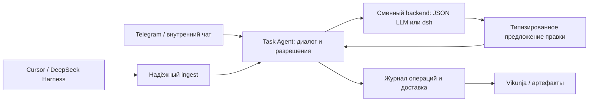

# FlowCI — ревью реализации и проверка пользовательских путей

Дата: **8 ноября 2026**, Europe/Moscow. Версия отчёта: **v1**. Каталог: `C:\projects\flowci`, приложение `flowci 0.1.0`.

**Заключение: идея полезная, выбранный небольшой стек подходит для пилота, но текущая реализация ещё не готова к самостоятельному ежедневному ведению задач.** Успешные демонстрационные сценарии работают с настоящими RouterAI и Vikunja. Однако обычное дополнение задачи стирает исполнителей и напоминания Vikunja; уточняющий диалог теряет постановку; события и подтверждения не восстанавливаются после части сбоев. Начинать пилот с важными рабочими данными до устранения этих проблем я не рекомендую.

DeepSeek Harness действительно существует и заслуживает эксперимента. **Переписывать сейчас весь Task Agent на него я бы не стал.** Сначала нужны устойчивые правила изменения данных и завершённый пользовательский цикл. Harness может дать сессии и инструменты, но не заменяет эти правила.

## Что именно проверено

Прочитаны все модули `src/flowci`, штатные тесты, Cursor hook и skill, bootstrap, README и `docs/concept/Task_Agent_Concept.md`. Концепция рассмотрена как рабочий источник продуктовых требований, а не как команды для исполнения. У документа статус несогласованной концепции; расхождения с ним отделены от воспроизведённых дефектов. Отложенные BookStack, Redmine, роли, несколько IDE и Symphony не записаны в недоработки текущего пилота.

В каталоге отсутствует `.git`, поэтому commit/branch установить нельзя. Для воспроизводимости сохранены [SHA-256 проверенных исходников](evidence/review-2026-11-08-v1/source_manifest.json). Codebase-memory MCP в доступных инструментах отсутствовал; использовались поиск по коду и чтение файлов.

Проверка выполнялась в существующем Python 3.13.1 на Windows. Настроенные ключи использовались программно, их значения в отчёт и трассы не выводились. Основные версии: Vikunja 2.8.0, OpenAI SDK 3.46.0, aiogram 3.31.0, aiohttp 3.14.5, APScheduler 3.11.3. [Сводка окружения и замеров](evidence/review-2026-11-08-v1/run_summary.json).

| Уровень | Фактически выполнено | Результат |
|---|---|---|
| Штатный suite | `python -m pytest -q` | **27 passed**, 5,86 с |
| Зависимости и синтаксис | `pip check`; `compileall` для `src` и hooks | Успешно |
| Живая модель и трекер | 30 записанных chat-вызовов RouterAI + отдельный настоящий CLI chat-вызов; отдельные Vikunja/SQLite на портах 3457 и 3458 | Рабочие и сломанные пути подтверждены ниже |
| Голос | Синтетическая русская речь → OGG/Opus → настоящий STT `openai/whisper-1` → настоящий chat → Vikunja | Задача, исполнитель, срок, транскрипт и файл сохранены |
| Telegram handlers | В живом прогоне настоящий Dispatcher и ядро с подменой Bot API transport; в негативных probes также FakeLLM/FakeVikunja | Текст, файлы, голос, кнопки и отказы проверены |
| Telegram API | Настоящие `getMe` и `getWebhookInfo` | Токен работает; webhook отсутствует; на момент запроса pending updates = 0 |
| HTTP ingest | Настоящий aiohttp listener → настоящий TaskAgent → RouterAI → Vikunja | Health/auth/validation, запись и повтор проверены |
| UI | Вход и просмотр созданной/обновлённой карточки в браузере | Срок, шапка, метки и комментарии отображаются |
| Негативные интеграции | 26 изолированных проверок handlers/SQLite/HTTP/hook/scheduler | **15 ожиданий выполнены, 11 нарушений воспроизведены** |
| Дефекты ядра | 9 отдельных детерминированных воспроизведений | **9/9 заявленных дефектов подтверждены** |
| Продуктовые свойства | 7 изолированных probes диалога, календаря, персонального плана и заметок | **7/7 проверенных пробелов воспроизведены** |
| Сохранность API-полей | Отдельная живая карточка с исполнителем, избранным, reminder и native HTML | Подтверждены потери полей и несовместимость парсера |

Числа разных уровней нельзя складывать в единый процент E2E coverage: это разные выборки, в том числе целевые воспроизведения ошибок. Детерминированные probes с FakeLLM проверяют реакцию кода на конкретный ответ модели, а не вероятность такого ответа в жизни.

**Граница проверки:** это расширенная интеграционная/E2E-проверка на реалистичных синтетических данных, а не полностью живой Telegram/IDE пилот. Сообщения в реальные Telegram-чаты не отправлялись; long polling и пользовательское нажатие в настоящем Telegram-клиенте не проходились. Stop-событие запущенного Cursor не вызывалось: hook проверен отдельно и в изолированных процессах. Не проводились многодневная эксплуатация, нагрузочный прогон и чистая установка на другой машине. Поэтому назвать все внешние пользовательские пути полностью прошедшими live E2E было бы неверно.

Рабочие `.env`, `data/flowci.db` и рабочая база Vikunja не изменялись. Все карточки создавались в отдельных тестовых БД. Тестовые серверы после работы остановлены; исходная Vikunja на 3456 оставлена работающей. Исправления приложения в рамках ревью не вносились.

## Матрица пользовательских путей

Обозначения: **LIVE** — настоящие RouterAI/Vikunja, **TG adapter** — настоящий обработчик, синтетический Telegram transport, **isolated** — управляемые внешние зависимости.

| Путь | Проверка | Фактический исход |
|---|---|---|
| Первое `/start`, закрепление владельца | isolated | Работает; второй пользователь не перехватывает уже закреплённого владельца |
| Чужой пользователь/чужое подтверждение | isolated и TG adapter | Игнорируется, задача не закрывается |
| Владелец пишет в группу | isolated | **Провал:** приватный план отправляется в группу |
| Новая задача с исполнителем «я» и точной датой | LIVE | Создана, назначена, срок и метки сохранены |
| Задача из русского голосового сообщения | LIVE + TG adapter | Работает; полный маршрут STT → карточка занял 7,8 с |
| Задача по содержимому `.txt` | LIVE + TG adapter | **Провал:** файл скачан, но содержимое модель не получила |
| Создание без части реквизитов → короткий ответ | LIVE | **Провал:** исходная постановка потеряна |
| Явно бессрочная задача | LIVE | Отклонена требованием назвать срок; расхождение с концепцией |
| Поручение Ивану | LIVE | **Провал:** успешный ответ, но исполнитель отсутствует |
| Поиск известного ID / отсутствующего ID | LIVE | Работает |
| Повторное создание похожей задачи | LIVE | Дубль не создан, возвращена существующая задача |
| Два похожих кандидата → выбор номера | LIVE | Первый вопрос корректен; **продолжение потеряло обновление**, выполнив только поиск |
| Обновить результат/следующий шаг | LIVE | Текст обновлён, статус/срок сохранены; **исполнитель стёрт** |
| Перенести только дедлайн на точную дату | LIVE | Дата изменена, статус, план и свободный текст сохранены |
| Дедлайн «завтра» | LIVE | Вместо вычисления даты бот спросил календарную дату |
| План сегодня / завтра / неделя / позже | LIVE | Метки фильтруются, срок от просмотра не меняется |
| Персональность/сортировка/переход на следующий день | isolated + код | Не реализованы в требуемом смысле; см. F13 |
| Сменить статус на «В работе» | LIVE | Работает, но общий дефект сохранности полей остаётся |
| Закрыть → отменить | LIVE + TG adapter | Задача осталась открытой |
| Закрыть → подтвердить → нажать повторно | LIVE + TG adapter | Закрылась один раз; повтор отвергнут |
| Временная ошибка при подтверждении | isolated | **Провал:** токен потерян, ответа пользователю нет |
| Удалить без подтверждения / с `--confirm` | LIVE через ядро | Сначала запрос подтверждения, затем удаление в тестовой БД |
| Заметка без задачи | LIVE | Сохранена, лишней задачи нет; **из отчёта и последующего контекста недоступна** |
| Напомнить через минуту | LIVE | Запись и наступившая доставка в тестовый sender проверены |
| Напомнить в точное московское время | LIVE | 09.11.2026 10:00 MSK сохранено как 07:00 UTC |
| Напоминание при недоступном канале / до `/start` | isolated | **Провал:** помечается отправленным без доставки |
| Утренняя сводка | LIVE, прямой вызов | Формируется; срабатывание cron в 09:00 в реальном чате не проверялось |
| Недельный отчёт | LIVE | Формируется, но **теряет заметку встречи и часть реально записанных результатов** |
| IDE-прогресс и повтор того же события | LIVE HTTP | Задача дополнена, не закрыта, повтор `noop=true` |
| IDE-событие требует уточнения | isolated HTTP/hook | **Провал:** вопрос недоступен пользователю, событие завершено как обработанное |
| Ingest без токена / неверное тело | LIVE HTTP | 401 / 400; health 200 |
| Падение между claim и finish; частичная запись | isolated | **Провал:** нет корректного восстановления |
| Два одновременных обновления | isolated | **Провал:** оба успешны, одна правка потеряна |
| Недоступный ingest при остановке IDE | isolated process | Hook отпускает IDE; **надёжной последующей доставки нет** |
| Настоящий CLI, план | LIVE process | Вывод корректен, exit 0 |
| Настоящий CLI, Vikunja недоступна | process | **Провал:** сообщение об ошибке с exit 0 |

Основные трассы: [live_results.json](evidence/review-2026-11-08-v1/live_results.json), [extended_results.json](evidence/review-2026-11-08-v1/extended_results.json), [integration_repro.json](evidence/review-2026-11-08-v1/integration_repro.json). Сырые ответы модели: [основной прогон](evidence/review-2026-11-08-v1/model_trace.json), [дополнительный прогон](evidence/review-2026-11-08-v1/extended_model_trace.json).

## Дефекты в порядке исправления

P1 — исправить до пилота с рабочими данными; P2 — исправить до признания соответствующего сценария готовым. Подтверждённых P0 в проверенном объёме нет.

### F01 · P1 · Дополнение задачи стирает исполнителей, избранное и native reminders

**Место:** `src/flowci/vikunja.py:135`, `:240`.

На живой Vikunja: создание → `assign_me` → обычный append. Исполнитель `review` исчез. Отдельная карточка дополнительно имела `is_favorite=true` и reminder на 30 ноября; после изменения только следующего шага поля стали `assignees=null`, `is_favorite=false`, `reminders=null`. Это прямое разрушение данных при повседневной операции. `_writable` отправляет неполную модель, а POST Vikunja сбрасывает пропущенные поля. Комментарий модуля о сохранении остальных полей не соответствует фактическому поведению.

**Исправление:** проверенная по API полная writable-модель на основе свежего состояния с наложением только разрешённой правки. Обязательно закрепить контрактным тестом на настоящей Vikunja. `index` и Kanban bucket в проверке сохранились — их потерю не утверждаю. [Доказательство до/после](evidence/review-2026-11-08-v1/vikunja_live_repro.json).

### F02 · P1 · Уточнение не продолжает исходное поручение

**Место:** `src/flowci/agent.py:253`, `:556`; `src/flowci/telegram.py:109`.

Живой диалог: «Создай задачу “Подготовить демонстрацию Cedar”» → «Кто и к какому сроку?» → «Я, до 2026-11-21. План на завтра». Агент решил уточнять уже существующую задачу Atlas. В другом случае после выбора из двух Orion-задач ответ «Для поиска, задача #3» вызвал только `find`; ранее переданные baseline/следующий шаг не записались.

Модель получает одно текущее сообщение и снимок задач. Ни постановка, ни заданный вопрос, ни ожидаемые поля не сохраняются. **Исправление:** состояние диалога по пользователю/чату, черновик операции и ожидаемое уточнение. После ответа продолжать эту операцию, а не классифицировать обрывок заново. Нужны двух- и трёхходовые acceptance tests.

### F03 · P1 · Владелец может случайно раскрыть личный план группе

**Место:** `src/flowci/telegram.py:28`, `:109`, `:150`.

Проверяется `from_user.id`, но не тип/ID чата. Synthetic update от владельца в группе `-1001` заставил обработчик сформировать `sendMessage(chat_id=-1001)` с полным приватным планом; метод перехвачен тестовым transport без обращения в Telegram. README обещает игнорировать чужие чаты, а реализована только фильтрация отправителей.

**Исправление:** до обработки и отправки разрешать приватный привязанный чат; для групп нужна отдельная явная настройка разрешений. То же ограничение применить к `/start` и callbacks. Это доказанный дефект обработчика, не факт утечки в реальную группу.

### F04 · P1 · Вопросы по событиям IDE теряются

**Место:** `src/flowci/ingest.py:95`; `.cursor/hooks/task-sync.py:133`; `src/flowci/agent.py:194`.

При `action=ask` ingest возвращает вопрос только в HTTP. Hook читает и игнорирует body; отправки вопроса владельцу нет. При этом `ok=true` завершает dedupe-запись. Повтор того же события становится `noop`; пользователь не видит вопрос и не может продолжить действие.

**Исправление:** сохранять исходное событие в состоянии `awaiting_input`, ставить доставку адресного вопроса в outbox и связывать ответ с этим событием. `ask` не должен означать окончательное выполнение операции.

### F05 · P1 · При сбое нет надёжного восстановления событий и частичных записей

**Место:** `src/flowci/store.py:129`; `src/flowci/agent.py:156`, `:384`; `.cursor/hooks/task-sync.py:96`, `:149`.

Подтверждены четыре разных окна потери:

- После сохранённого `inflight` и перезапуска повтор навсегда становится `noop`, хотя модель/запись ещё не отработали.
- Карточка создана, `add_comment` вернул 500: пользователь получил ошибку. Повтор того же ключа встретил похожую карточку, зафиксировал `ask`, исходный комментарий не восстановился.
- При недоступном ingest hook не оставляет durable outbox. Следующая перезапись `session.json` уничтожает недоставленный факт. HTTP 200 с `ok:false` тоже игнорируется.
- В hash hook не входят `artifacts` и `project`: замена только `results-v1.csv` на `results-v2.csv` даёт тот же ключ, новое evidence теряется.

**Исправление:** журнал входящих событий с полным payload, lease/восстановлением `inflight`, этапами внешней записи и известным `task_id`; отдельный outbox с retry/ack. Ключ должен отражать каноническое содержимое события либо устойчивый уникальный event ID. Сохранить текущее полезное свойство: сбой hook не блокирует IDE.

### F06 · P1 · Одновременные успешные операции перетирают друг друга

**Место:** `src/flowci/agent.py:169`, `:425`, `:474`; `src/flowci/vikunja.py:135`.

Детерминированный concurrent `append(next_step)` + `change_status(В работе)` дал два `ok=true`, но финальный статус остался «Нужно сделать». Снимок берётся до ожидания LLM, затем устаревшие поля записываются обратно. Новое GET внутри клиента не спасает, поскольку редактируемые поля берутся из старого `Task`.

**Исправление:** сериализовать изменения одной карточки и применять узкую правку к свежему состоянию; учитывать внешние правки UI, а не только конкурентность одного Python-процесса. [Воспроизведение](evidence/review-2026-11-08-v1/core_repro.json).

### F07 · P1 · Разрешённые поля правки почти полностью определяет модель

**Место:** `src/flowci/agent.py:283`, `:412`, `:672`.

В управляемом ответе модели событие Cursor предлагало закрытие с посторонним `due_date=2030-01-01` и неподтверждённым `confirmed_result`. Защита правильно сняла закрытие, но превратила действие в append и записала оба остальных поля. Значит, правило «срок меняется только по явному переносу человеком» существует в prompt, но не обеспечено кодом. Непроверенное утверждение может стать «Последним подтверждённым результатом».

**Исправление:** типизированные команды и проверка разрешённых полей по источнику/основанию; отдельный путь подтверждённых результатов. Не полагаться на `confidence` модели как на разрешение. Этот probe доказывает поведение при таком ответе модели, а не наблюдавшуюся live галлюцинацию.

### F08 · P1 · Недельный отчёт теряет сохранённые результаты

**Место:** `src/flowci/agent.py:428`, `:502`, `:508`; `src/flowci/formatting.py:221`.

В живом прогоне baseline и `latency 42 мс` появились в шапке задачи, но модель не добавила `payload.comment`. `_append` поэтому не записал комментарий. `_report` читает только комментарии: измерение не попало в недельный отчёт. Сохранённая заметка встречи про cosine similarity тоже отсутствовала. Локальные notes/artifacts не участвуют ни в следующем решении, ни в отчёте.

При этом раздел «Подтверждённые факты» содержит само поручение «Создай задачу…» и текст присланного harness-события, без проверки существования указанного артефакта. Метка комментария пока означает доверие к формулировке модели/источника, а не верификацию результата.

**Исправление:** обязательная запись каждого изменения как активности с исходным сообщением, временем, автором и evidence; отчёт строить по активностям, заметкам и артефактам с чёткой семантикой подтверждения. Проверяемое достижение, поручение и заявление об исполнении должны различаться.

### F09 · P2 · Файл сохраняется, но не анализируется

**Место:** `src/flowci/telegram.py:87`, `:100`.

Передан `.txt` с названием Omega, исполнителем, точным сроком и контрольной строкой `OMEGA_8421`. В модель ушли только имя, локальный путь и caption. Живой ответ: просьба прислать содержимое уже приложенного файла. Модель не имеет инструмента чтения этого пути. Уточнение также оставляет artifact без связанной задачи.

**Исправление:** хотя бы явная поддержка текстовых вложений с извлечением содержания; затем перечень поддерживаемых форматов и ограничения размера. Обработка исключений после download/STT у файлов и голоса должна отвечать пользователю так же последовательно, как текстовый handler.

### F10 · P2 · Неотправленное напоминание помечается отправленным

**Место:** `src/flowci/schedule.py:59`; `src/flowci/__main__.py:40`.

Три ошибки sender и следующая итерация дают `sent=1`, доставок ноль. Если владелец ещё не сделал `/start`, sender просто возвращает управление, что тоже считается успешной доставкой. Этот подкейс проверен настоящим scheduler с callback, воспроизводящим ветку `__main__.send`.

**Исправление:** состояния pending/sent/failed, явное подтверждение доставки, retry с backoff и восстановление после привязки владельца. Для нескольких получателей учитывать результат по каждому, иначе частичная доставка тоже ненадёжна.

### F11 · P2 · Подтверждение теряется при сетевой ошибке; успешная кнопка обходит аудит

**Место:** `src/flowci/agent.py:221`, `:205`; `src/flowci/store.py:260`; `src/flowci/telegram.py:49`.

`pop_pending` удаляет токен до обращения к Vikunja. При 503 исключение выходит из callback без ответа; повтор сообщает, что подтверждение уже использовано. При успешном закрытии/удалении `confirm()` напрямую вызывает `_change_status`, обходя аудит `handle()`: в SQLite остаётся первоначальный `ask`, а факта подтверждённого изменения нет.

**Исправление:** pending/executing/applied с безопасным повтором; аудит результата и подтверждающего пользователя; единая граница обработки ошибок callbacks. Нужны срок действия и привязка подтверждения к конкретному субъекту, если будет несколько сотрудников.

### F12 · P2 · Относительная дата не привязана к часам приложения

**Место:** `src/flowci/agent.py:253`, `:274`, `:718`.

В prompt отсутствуют текущая дата и timezone. В живом запросе «дедлайн завтра» модель спросила `YYYY-MM-DD`. Интервал напоминания работает, поскольку код сам прибавляет минуты; точное время с явно указанной Москвой тоже прошло. Это не означает, что естественные относительные сроки в общем случае работают.

**Исправление:** передавать локальные `now`, date и timezone, нормализовать их кодом. Naive `fire_at` сейчас трактуется как UTC; нужно явно определить локальную семантику и не принимать напоминание в прошлом без отдельного решения.

### F13 · P2 · План — постоянные метки, а не персональный календарный план

**Место:** `src/flowci/formatting.py:177`; `src/flowci/schedule.py:28`.

Фильтр выбирает метки, не учитывая исполнителя, приоритет и дедлайн при выборе/порядке. Задача со сроком сегодня без метки «Сегодня» в план не попадёт. Метка «Завтра» на следующий день остаётся «Завтра»: rollover отсутствует. При нескольких `TG_ALLOWED_USER_IDS` всем отправляется один и тот же проектный план.

**Исправление:** определить семантику плана: календарная дата работы + личный исполнитель либо явно ручные постоянные списки. Затем сортировка по приоритету/сроку, предложения переноса и проверка следующего дня. Последнее нужно тестировать управляемыми часами.

### F14 · P2 · Другой исполнитель принимается, но игнорируется

**Место:** `src/flowci/agent.py:364`, `:392`.

Живая задача Delta с исполнителем Иваном создана с успешным ответом и `assignees=[]`. Реализован только `assign_me`; ошибки этого назначения дополнительно проглатываются. **Исправление:** разрешать известного пользователя через API либо сообщать об ограничении и уточнять до создания, а не подтверждать невыполненное поручение.

### F15 · P2 · Сопоставление ограничено первыми 50 задачами

**Место:** `src/flowci/agent.py:255`.

При 51 задаче модель видит ровно первые 50. Поиск по известному ID ещё может работать через код, но смысловое сопоставление обновления с остальными задачами модели недоступно. **Исправление:** retrieval кандидатов, чтение выбранной карточки и истории; оценка качества сопоставления на корпусе похожих задач.

### F16 · P2 · Native rich text ломает разбор структурированной шапки

**Место:** `src/flowci/formatting.py:59`, `:96`.

Описание с `<p>Ожидаемый результат: …</p>` целиком распознаётся как свободный body. После append появляется новая шапка с «—» вместо результата и подтверждения, а прежний шаг остаётся ниже внутри HTML. Старый текст физически сохранён, но структурированное состояние и контекст модели неверны. Проверено с настоящим API-описанием в native HTML; UI-редактирование этого rich text отдельно не автоматизировалось.

**Исправление:** согласованный round trip с форматом Vikunja; структурированные метаданные не извлекать хрупко из произвольного пользовательского rich text. [До/после](evidence/review-2026-11-08-v1/vikunja_live_repro.json).

### F17 · P2 · CLI сообщает автоматизации об успехе при отказе зависимости

**Место:** `src/flowci/cli.py:25`, `:59`.

Настоящий процесс с недоступной локальной Vikunja напечатал «Vikunja сейчас недоступна», но завершился с **exit 0**. `_run` выбрасывает `result.ok`, возвращая только текст. **Исправление:** ненулевой exit при технической ошибке, желательно машинный JSON-режим. Для нормального запроса уточнения можно оставить отдельную явно определённую семантику. [Доказательство](evidence/review-2026-11-08-v1/cli_failure.json).

## Оценка задумки и практической полезности

Сильная часть концепции — разделение задачи, активности и артефакта, раздельные дедлайн и план работы, отказ от автоматического закрытия по коммиту. Vikunja как источник истины, один процесс Python и один источник IDE-событий разумны для проверки гипотезы. Нет необходимости сразу добавлять BookStack, Redmine или большой механизм оркестрации.

В короткой практической сессии агент удобен **при полном одноходовом поручении**: текст → задача занял 6,5 с; голос → задача 7,8 с; обычные операции чаще укладывались в несколько секунд. По 30 записанным chat-вызовам медиана — **4,09 с**, диапазон **2,65–11,27 с**, p95 ближайшего ранга — **9,32 с**. Это измерение конкретной конфигурации `openai/gpt-6.1-sol` через RouterAI, не SLA и не нагрузочный benchmark. Стоимость не измерялась.

Как повседневный помощник он пока возвращает пользователю ручную работу: надо повторять постановку после вопросов, самому читать вложение, проверять исполнителя после обновления, помнить о потерянных событиях и сверять отчёт с карточками. Это против главной цели продукта — уменьшить усилия на трекинг. Сейчас точнее назвать приложение **работающим прототипом интерфейса к трекеру**, чем завершённым Task Agent.

Отдельные продуктовые решения нужно согласовать до расширения:

- **Бессрочные задачи:** концепция §8.3 допускает отсутствие дедлайна, а prompt и код требуют его. Даже явное «срока нет и ставить не надо» не принимается. Это воспроизведённое расхождение замысла и реализации, а не случайная ошибка модели. Я бы разрешил явный `no_deadline`, отделив его от неизвестного срока.
- **Персональный или командный продукт:** текущая БД, проект, заметки и напоминания общие; allowlist — не модель сотрудников. Для одного владельца это упрощение, для подразделения требуется идентификация и область видимости.
- **Один запрос — несколько действий:** сейчас Decision содержит одно действие. Поручения вида «перенеси срок, поставь В работе и напомни» не имеют надёжного контракта исполнения. Для MVP можно явно ограничить UX; далее нужен типизированный список операций с проверяемым результатом каждой.
- **Подтверждение фактов:** нужен ответ, что считается доказательством — утверждение человека, сообщение харнесса, реально доступный файл, успешный тест или принятый PR. Сейчас это в основном метки текста.

Перед переносом пилота на другие машины следует также убрать фиксированные `C:/projects/flowci` из `scripts/bootstrap.ps1:306`, `:312`, `:314`, зафиксировать зависимости и дать воспроизводимый запуск. Bootstrap сейчас формирует token со всеми route permissions на десять лет (`:677`); для будущего рабочего контура нужен ограниченный набор прав и управляемое обновление. Чистый bootstrap в этом ревью не запускался, чтобы не изменять существующую установку.

Для банковского применения сама on-premise Vikunja ещё не делает весь поток локальным: снимки задач уходят в RouterAI, аудио — в STT, ответы — в Telegram. Это фактическая архитектура кода, которую нужно сопоставить с уже отмеченными в концепции ограничениями данных. Разрешённый внутренний канал можно заменить через адаптер, не меняя правила ядра.

## DeepSeek Harness: стоит ли вписать

Под названием из вопроса понимаю **DeepSeek Harness (`dsh`)**, официальный open-source проект DeepSeek на Cordis с плагинной архитектурой и MIT-лицензией. Его существование и документация проверены по [официальному репозиторию](https://github.com/deepseek-ai/deepseek-harness), а не по предположению о модели DeepSeek.

Он подходит для эксперимента с инструментами и долгими сессиями. [Python SDK](https://github.com/deepseek-ai/deepseek-harness/blob/master/python/sdk/README.md) запускает отдельный runtime по JSON-RPC/stdin-stdout, поддерживает явный home и восстановление сессии. Это дополнительный процесс и жизненный цикл, которые придётся сопровождать. Runtime в этом ревью не устанавливался; сравнительного benchmark с текущим агентом нет.

Для решения о внедрении существенна зрелость: авторы обозначают проект как developer preview; в [SAFETY.md](https://github.com/deepseek-ai/deepseek-harness/blob/master/SAFETY.md) прямо указаны отсутствие security audit и непригодность считать его production-ready, а sandbox не гарантирует изоляции. Это ограничение конкретного рассматриваемого компонента.

**Моя рекомендация — два последовательных эксперимента.**

1. Подключить `dsh` как рабочий харнесс — ещё один источник того же `task-sync` контракта. Task Agent получает его события и продолжает владеть задачами, подтверждениями и журналом. Так он полезен без полной миграции.
2. После исправления F01–F08 сделать сменный backend принятия решений через SDK и сравнить на одном наборе сценариев. Дать ему узкие инструменты поиска задач/истории, подготовки правки, заметок и запроса уточнения. Финальное применение всегда проходит через Python policy layer.



Это предлагаемая архитектура, не уже выполненная интеграция. Для опыта нужны отдельный home, зафиксированная версия runtime, ограниченные инструменты и бюджеты времени/шагов. Само имя профиля `minimal` не следует считать гарантией отсутствия shell — разрешения надо проверить явно. Долговечность события и подтверждения должна обеспечиваться нашим журналом, а не только историей harness-сессии.

Критерий выбора: доля корректных сопоставлений и выполненных поручений, количество повторных вопросов, ложных изменений, восстановление после сбоя, задержка и стоимость. **Потенциал dsh есть; утверждать, что он уже обеспечит более хорошую реализацию FlowCI, пока оснований нет.** Большая часть обнаруженных проблем находится в исполнении операций и данных вокруг модели.

## Что делать дальше и когда считать пилот готовым

1. Исправить сохранность API-полей и конкурентные записи; ввести строгую модель разрешённых изменений. Проверить прямым GET после каждой мутации.
2. Замкнуть уточняющий диалог и доставку вопросов из ingest; передавать часы и timezone; поддержать явно бессрочные задачи.
3. Добавить журнал событий/операций и outbox, восстановление `inflight`, частичных записей, подтверждений и напоминаний.
4. Обеспечить извлечение текстовых вложений, поиск заметок/истории и полный отчёт по активностям; определить доказательство результата.
5. Уточнить личную модель плана и проверить следующий календарный день; закрыть групповой доступ до явной настройки.
6. Повторить acceptance suite на живом Telegram и настоящем stop hook выбранной IDE. Затем провести предусмотренный концепцией пилот 2–3 сотрудников на 1–2 недели.

Минимальные ворота пилота: ни одно неизменяемое поле не теряется; двухходовое уточнение выполняет исходную операцию; повтор/падение не теряет событие и не дублирует результат; неподтверждённое закрытие невозможно; отказ доставки не считается успехом; отчёт содержит все внесённые контрольные результаты со ссылками на источник; личные данные не уходят в групповой чат. Метрики полезности из концепции стоит измерять уже после этих ворот.

## Как воспроизвести проверку

Все дополнительные материалы лежат в `reviews/evidence/review-2026-11-08-v1/`. Скрипты не являются исправлениями приложения.

Из корня проекта:

```powershell
$env:PYTHONPATH = 'src'
$env:PYTHONIOENCODING = 'utf-8'
.\.venv\Scripts\python.exe -m pytest -q
.\.venv\Scripts\python.exe reviews/evidence/review-2026-11-08-v1/core_repro.py
.\.venv\Scripts\python.exe reviews/evidence/review-2026-11-08-v1/integration_repro.py
.\.venv\Scripts\python.exe reviews/evidence/review-2026-11-08-v1/product_repro.py
```

Эти probes воспроизводят нарушения ожиданий; успешный exit скрипта означает, что воспроизведение выполнено, а не что приложение не содержит дефектов. Переданный модели ответ намеренно фиксирован там, где проверяется исполнение решения.

Живые прогоны используют настроенный RouterAI и оплачиваемые вызовы, создают собственные runtime-каталоги и сами останавливают свои Vikunja-процессы:

```powershell
.\.venv\Scripts\python.exe reviews/evidence/review-2026-11-08-v1/live_review.py
.\.venv\Scripts\python.exe reviews/evidence/review-2026-11-08-v1/extended_review.py
```

Для второго нужен сохранённый `voice-fixture.ogg`; он создан локально из синтетической речи, реальной пользовательской записи в evidence нет. Живые ответы модели при повторном запуске могут отличаться. Скрипты ставят временной предел тестового сетевого вызова; это ограничение стенда, не свойство приложения. `vikunja_live_repro.py` — дополнительный probe уже поднятого изолированного fixture на 3457, а не рабочего экземпляра на 3456.

Сохранённая карточка в браузере после обновления:


**Итоговое решение:** сохранить направление и небольшой стек, сначала исправить целостность и полный пользовательский цикл. DeepSeek Harness подключать контролируемо как источник событий и затем как сравниваемый backend. Текущую версию считать прототипом, которому ещё предстоит доказать надёжность в ежедневной работе.
